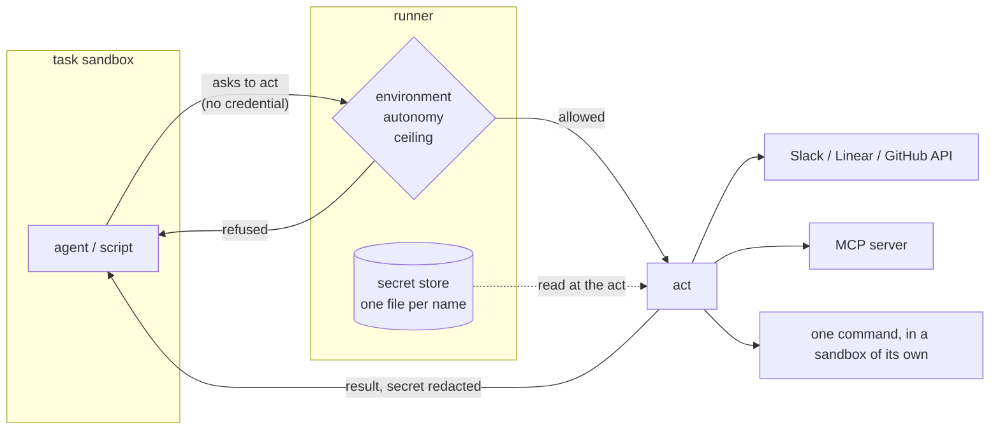
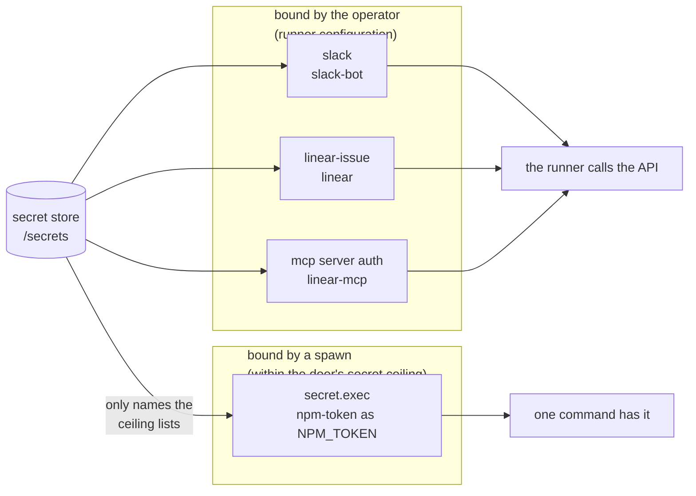
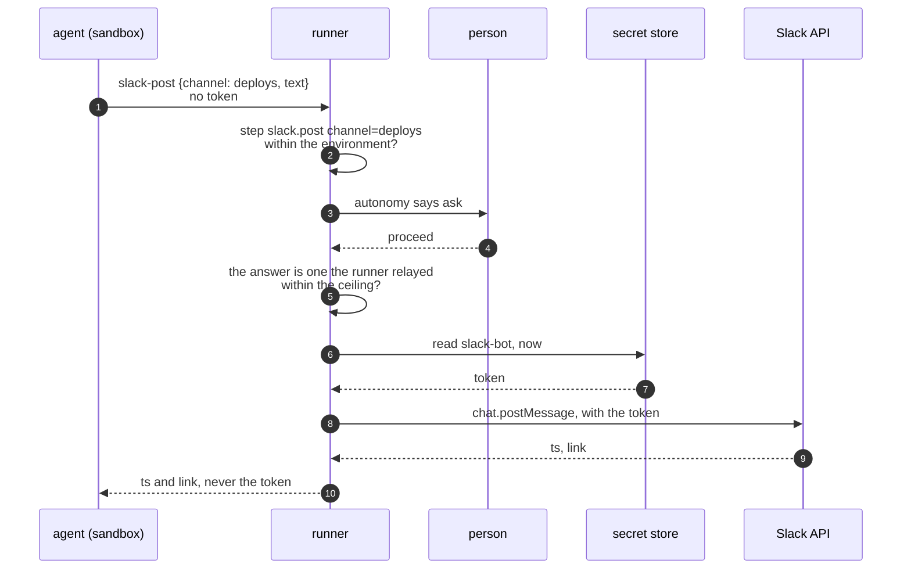
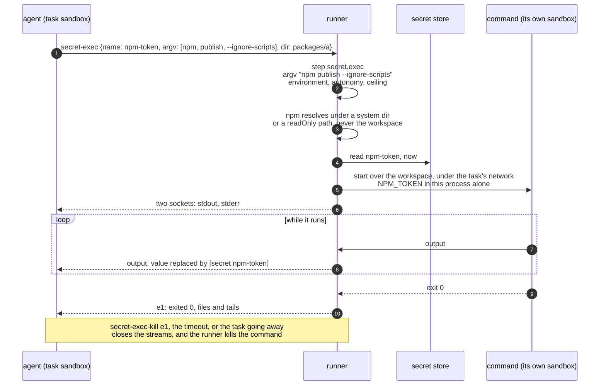
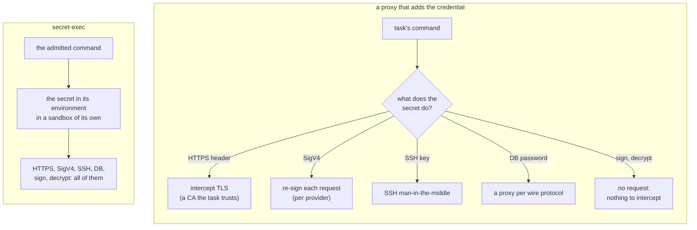
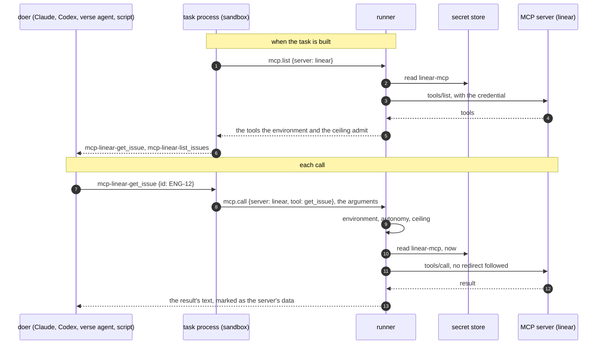
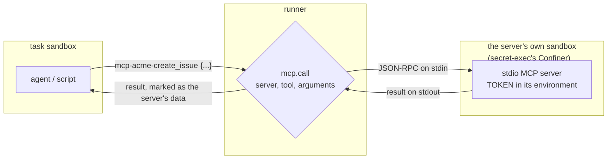
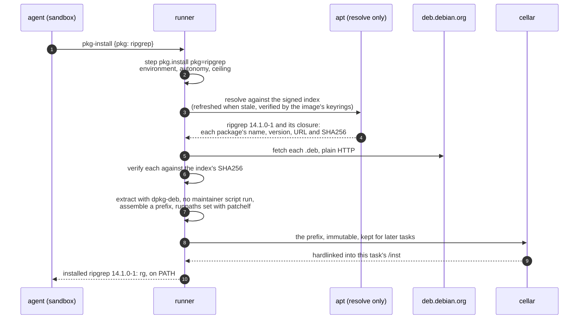
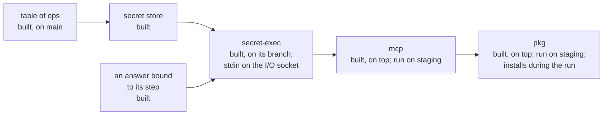

# Making verse work with external tools and secrets

*Written in November 2026, as the three systems landed on their branches and ran on staging.
True as of then; the published docs ([systems](../systems/README.md#what-a-task-lacks)) are kept
true as the tree moves.*

A verse task works in a sandbox. Today it can use the tools its runner implements (`git`,
`github`, `slack`, `linear-issue`, `verse`) and the programs the runner's image carries. It
still can't:

- **call a tool that someone else's server offers**, such as an MCP server;
- **use a package the image doesn't carry**, such as a toolchain, a CLI or a library;
- **run a command that needs a credential**, such as `npm publish`, `cosign sign` or a migration
  against a database.

This page covers all three. Each one becomes **one more system** in verse's systems model, so
there is no second vocabulary to learn. A spawn's `environment` says what a task gets, the
runner's `ceiling` bounds it, and the `autonomy` decides each act. The runner holds every
credential, in one store.

---

## The rule under all of it

> **A task never holds a credential, and never chooses which credential goes where.**

The runner holds the credential, and the runner acts. Before each act it checks three things
again, from its own copy of each:

| | Who writes it | What it says |
|---|---|---|
| **environment** | whoever spawned the task | what this task is given: which channel, which server, which command |
| **autonomy** | whoever spawned the task | for each act: `allow`, `deny`, or `ask` a person |
| **ceiling** | the runner's operator | the most any task of this doer may be given, whatever a spawn says |



---

## One store, bound in two ways

**The store** is a directory the deployment mounts, such as a Kubernetes Secret volume. It
holds one file per secret, and the file's name is the secret's name:

```tony
secrets: {dir: /secrets}
```

- The runner reads a value **at each use**, so when a secret is rotated, the next act uses the
  new value. No restart is needed.
- A secret's **name is public**: it appears in the runner's description and in every spawn that
  uses it. The value appears in no log, no reply and no file the task can read.
- **A secret that is absent closes whatever needs it.** The runner says so when it starts, and
  verse refuses a spawn that needs it where the spawn is written, not halfway through a run.

There are two ways to give a secret to something that acts:

| Binding | Who makes it | Used by | Does the spawn name the secret? |
|---|---|---|---|
| **The operator binds a secret to a system** | the runner's configuration | `slack`, `linear-issue`, an MCP server's `auth` | **never**: the spawn names the channel or the server |
| **The spawn binds a secret to a command** | the spawn's `secret` block, within the ceiling | `secret.exec` | yes, by name, and the operator's ceiling must list that name |



A secret the operator bound to Slack can't reach a command, unless the operator also lists it in
that doer's `secret` ceiling. **Ceilings are closed by default.** (`pkg`, below, binds no secret
at all: its trust is the archive's signed index.)

---

## Existing system tools, with the store: Slack

Slack is the model for everything that follows. The task asks, and the runner posts with its own
bot token.

**Before the store,** the token was an environment variable with a fixed name,
`SLACK_BOT_TOKEN`. **With the store,** the operator names a file:

```tony
# the runner's configuration
secrets:
  dir: /secrets
  systems: {slack: slack-bot}        # /secrets/slack-bot holds the bot token
agents:
  claude:
    systems:
      slack: {ceiling: {post: {channel: deploys}, read: {channel: deploys}}}
```

**The spawn** names channels and verbs, and never a token:

```tony
spawn:
  agent: {name: claude}
  environment:
    systems:
      slack: {post: {channel: deploys}, read: {channel: deploys}}
  prompt: "Post the release notes for v1.3 in #deploys, then read the thread for objections."
  autonomy:
  - {match: {system: slack, verb: post, channel: deploys}, then: ask}
  - {match: {system: slack, verb: read}, then: allow}
  - {then: deny}
```

**What happens on a post:**



1. The agent calls `slack-post`. The call goes over the task's channel to the runner, with no
   token on it.
2. The runner works out the step (`slack.post`, `channel: deploys`) and checks it against the
   environment. The autonomy's `ask` row puts the question to a person, and the runner checks
   that it relayed that person's answer itself. It does not take the task's word for it.
3. The runner checks the ceiling: `post` to `deploys` is within it.
4. The runner reads `/secrets/slack-bot` **now**, posts, and returns the message's `ts` and link.

To rotate the token, replace the file; the next post uses the new one. If the file is missing
when the runner starts, `slack` is closed to every doer, and the runner says which secret it
looked for and where. `linear-issue` works the same way.

---

## Commands that need a secret: `secret-exec`

Some work needs a credential in a **process**, not in an API call the runner makes:
publishing a package, signing an artifact, running a migration. `secret-exec` is that.

**The operator** lists, for each doer, which secrets a task may run a command with and which
commands. `name` is the secret's file in the store, and `as` is the environment variable the
command sees it under, so a row reads "npm-token, as NPM_TOKEN, for this command":

```tony
agents:
  claude:
    systems:
      secret:
        ceiling:
        - name: npm-token
          as: NPM_TOKEN           # the variable the command gets the value in
          exec: {argv: !regexp "^npm publish --ignore-scripts( --tag [a-z]+)?$", dir: !glob "packages/*"}
      network:
        ceiling: {mode: allow, tcp-client: {host: registry.npmjs.org}}
```

**The spawn** gives the secret by name, under the same `as`, with the commands it may run and
where:

```tony
spawn:
  agent: {name: claude}
  environment:
    systems:
      network: {mode: allow, tcp-client: {host: registry.npmjs.org}}
      git: [{repo: acme/lib, from: main, fetch: {}}]
      secret:
      - name: npm-token
        as: NPM_TOKEN
        exec: [{argv: "npm publish --ignore-scripts", dir: !glob "packages/*"}]
  prompt: "Publish each package under packages/ whose version is not yet on the registry."
  autonomy:
  - {match: {system: secret, verb: exec}, then: ask}
  - {then: allow}
```

**What the task calls:**

```json
{"tool": "secret-exec",
 "name": "npm-token",
 "argv": ["npm", "publish", "--ignore-scripts"],
 "dir": "packages/a"}
```

**What the runner does:**



- It reads the call into one step: `secret.exec` with `name: npm-token`, `as: NPM_TOKEN`,
  `argv: npm publish --ignore-scripts` and `dir: packages/a`. The command is spelled as one
  line, so a pattern and a person read it as a command line. Where one argument ends is never
  ambiguous, because the call gives a list.
- It checks the step against the environment, the autonomy and the ceiling. Plain variables are
  checked **closed**: a variable that no shape names makes the call outside the environment.
- It runs `npm` only if `npm` resolves under a system directory or a path the operator keeps
  read-only. It never runs a program from the workspace.
- It reads the secret, then starts the command **in a sandbox of its own**, over the task's
  workspace and under the task's network, with `NPM_TOKEN` in that process alone. The task's own
  processes are in another pid namespace and can't read it.
- It streams stdout and stderr back to the task, **with the value redacted**, as
  `.verse/exec/e1.out` and `.err` in the workspace, plus two sockets a shell can read along from
  while the command runs.
- With `stdin: true` — a field of the step, false where a shape says nothing of it — the same
  socket carries input back ([`hnp7jgfk`]): the task writes the command's stdin at
  `.verse/exec/e1.in.sock`, its close is the command's EOF, and the output still flows. Nothing
  is redacted on the way in; the input goes to the process that already holds the secret.
- It answers `e1: exited 0` and the tail of each stream. `timeout` bounds the run, which is an
  hour at most. `secret-exec-kill e1` ends it, and so does the task going away.

### Why a command, and not a proxy that adds the credential

The obvious alternative is to leave the task's commands alone and let the **egress proxy add the
credential**. The proxy sees a request to `registry.npmjs.org`, adds `Authorization: Bearer …`,
and passes it on. The task never runs anything with the secret. Where that works, it is
stronger. It is still the wrong general shape, for four reasons.



**1. A credential is not always a header on a request.**

| What the secret does | What a proxy would have to be |
|---|---|
| a bearer token on an HTTPS API (npm, PyPI, a REST API) | a TLS-intercepting proxy that adds a header. Possible. |
| AWS SigV4 | a proxy that re-signs every request: method, path, body hash and time. Different code for each provider. |
| an SSH key (`git` to a non-GitHub host, `ssh deploy@…`) | a man-in-the-middle for SSH |
| a database password (Postgres SCRAM, MySQL) | a proxy for each wire protocol, taking part in its auth handshake |
| a TLS client certificate, a kubeconfig | a proxy that ends mutual TLS and starts it again |
| **signing an artifact** (`cosign`, `gpg`, `minisign`, `codesign`) | **nothing**: there is no request to intercept |
| **decrypting** (`sops`, `age`) or unlocking a keystore | **nothing**: it happens on the machine |

**2. HTTPS means interception.** Today's egress proxy decides by host on `CONNECT` and never sees
inside the tunnel. To add a header, the task would have to trust a CA the proxy holds. The proxy
would then see all of the task's traffic in the clear, and any client that pins its certificates
breaks.

**3. Every proxy shape is a new system.** Each service family needs its own document, verbs,
configuration, code and tests, and someone has to write each one before anyone can use it. N
services means N systems. **`secret-exec` is one system, written once**, and it works with
anything that can take a secret from an environment variable.

**4. `secret-exec` always has a way to fit.** Anything that uses a secret is, in the end, a
process that has the secret. So there is always a way to run it under `secret-exec`. At worst,
the operator keeps a small program on a read-only path that does exactly one operation, such as
`sign-release <file>`, and the ceiling admits that program and nothing else. A proxy has no
answer for "sign this file".

### What it costs, said plainly

> [!WARNING]
> `secret-exec` runs a command **with** the secret. What that command does with it is bounded by
> the shapes, and by nothing else.

- **An admitted command can show the secret.** An environment that admits
  `sh -c 'echo $NPM_TOKEN'` leaks it, and that leak belongs to whoever wrote the environment.
  The runner runs what the environment admits and does not judge commands.
- **Redaction is only a second line.** It catches the value when it appears whole. An encoded
  value, or one split up by the command's own formatting, gets through.
- **The program check covers `argv[0]` and nothing more.** Whatever that program runs also gets
  the secret: `npm publish` runs the package's lifecycle scripts unless the command says
  `--ignore-scripts`, and an interpreter runs whatever it is handed. **Write shapes for what a
  command does, not for its name.**
- **The network decides where the secret can go.** The command reads its configuration from the
  workspace, which the task can write. Pair every `secret` block with a network that reaches the
  one host the command needs, in the ceiling as well as the spawn.

So the order of preference is:

| | Who runs code with the secret | What a person approves | Cost of each new service |
|---|---|---|---|
| **a performed system** (`slack`, `git`, `mcp`) | the runner's own code | the act: channel, ref, server and tool | one system each |
| **`secret-exec`** | the admitted command, in its own sandbox | the command line, the directory and the variables | nothing: one ceiling block |
| **a credential-adding proxy** | nobody | a host | one proxy for each protocol, and TLS interception |

**Use a performed system where one exists. Use `secret-exec` for everything else.** That's the
general case; nothing narrower covers it.

---

## MCP servers: tools another server offers

> **Status:** built, on `verse/mcp` over `verse/secret-exec` ([`1v5art3x`]), through six review
> rounds: the document and the step, the configuration, the client, the two requests the task
> makes (`mcp.list`, `mcp.call`), the tools in the task's process, and the words, in eight
> commits (ae114ac9 to f9c91b54), and run on staging against Linear's `/mcp/readonly` and
> Signadot's production server: a script and a Claude task each read a Linear issue through the
> runner, and a script listed the Signadot org's clusters, each call asked about with its
> arguments. That run found that a tool taking nothing (the server's `list_*`) was kept from
> scripts, fixed at f9c91b54. A review of the whole stack later added 8ec51378, one tool-name
> bound for every doer. The staging server is configured and keyed, and waits on a server-side
> fix.

The runner is the MCP client. The operator names remote servers and how the runner
authenticates to each one; the credential comes from the store. A spawn names the server and the
tools it may use:

```tony
# the runner's configuration
secrets: {dir: /secrets}
mcp:
  servers:
    linear: {url: "https://mcp.example.com/mcp", auth: {secret: linear-mcp}, timeout: 60s}
    search: {url: "https://search.example.com/mcp", auth: {secret: search-key, header: X-Api-Key}}
agents:
  claude:
    systems:
      mcp: {ceiling: [{server: linear, call: {tool: !glob "get_*"}}]}

# a spawn's environment
environment:
  systems:
    mcp: [{server: linear, call: {tool: !or [get_issue, list_issues]}}]
```



- When the task is built, the runner lists each server's tools and offers each one as
  `mcp-<server>-<tool>`, such as `mcp-linear-get_issue`. Each use is one step, `mcp.call`, with
  `server` and `tool`.
- **Every kind of doer gets them through the same path:** Claude through the runner's own MCP
  server (Claude's own MCP configuration stays shut, under `--strict-mcp-config`), Codex as
  dynamic tools, the verse agent, and a script through `verse-call-tool`.
- Each call is decided again by the runner and performed **apart**, so a slow server doesn't
  hold up a push. The runner reads the credential at each request and follows no redirect, so a
  server can't choose where the credential goes.
- **What is sent is the step.** The call's arguments are read into the step as structure, and
  what goes to the server is that structure written back as JSON: nothing reaches the server
  that the step didn't say, and a `null` argument stays a `null` (Linear reads `assignee: null`
  as unassign and no `assignee` as unchanged, so the two are two different steps). A shape or a
  row matches the arguments **open**, as tony matches an object: `{team: ENG}` admits a call
  with any other argument beside it. A ceiling that has to pin an argument names it.
- **One session per task and server**, opened at the first call and closed with the task. A
  server that ended an idle session (mcp.signadot.com does, after 30 minutes) gets a new one,
  and the call is sent again only when the server's answer was to that call's own request;
  otherwise the task hears that whether the call was performed isn't known. **A call is never
  sent twice.**
- **What a server says is the server's.** A result the server marks as an error is what the
  model reads, not an error of the runner's. A tool the server hasn't got, arguments its schema
  refuses, or a tool that asks the client for input (the runner gives none) come back as a
  **refusal in the server's words**, which the task re-plans on. Results, descriptions and
  instructions are cut at bounds, and say so.

**What the staging runner's description now shows.** With Linear's MCP server named, a doer's
description carries the hand-built `linear-issue` system and `mcp` side by side, over one and the
same credential (`verse-linear`'s key, the store's `linear`):

```tony
    linear-issue:
      ceiling:
        close:
          issue: !glob ENG-*
        comment:
          issue: !glob ENG-*
        create:
          team: ENG
    mcp:
      builds:
        server: linear
        call: {}
      ceiling:
        server: linear
```

That suggests `mcp` could replace `linear-issue`: the server offers some ninety tools where the
system offers three verbs, a ceiling names tools and pins arguments (`{tool: save_issue,
arguments: {team: ENG}}`) as the system's shapes do, the approver is asked about the arguments
either way, and Linear keeps its own read-only line at `/mcp/readonly`, a bound the system never
had. What the system has that the server's tools don't is verse's own vocabulary: `create`,
`comment` and `close` with fields verse named and documented, stable across Linear's releases, and
cheaper to read in a question (`linear-issue.create team=ENG` against `mcp.call server=linear
tool=save_issue arguments={…}`). The same question stands for `slack` once a Slack MCP server is
named. Worth deciding once a few tasks have run on both; not decided here.

**Limitations, as built so far:**

| Limitation | Why | What lifts it |
|---|---|---|
| **Remote servers only** (streamable HTTP) | the runner would start a stdio server outside any sandbox, as the runner's user, next to its own tokens | `secret-exec`'s sandbox (below) |
| **The approver is asked about the arguments, but not shown them yet** | the arguments are now a field of the step (`arguments`), so rows match on them and an answer performs only the call it was given about ([`275art3x`]); a question shows only the tool and the verb today | the question showing a step's fields ([`q3k89kva`]) |
| **Very long arguments are refused** | the step is carried whole, in the task's events, its snapshot and a question's record, so arguments past 64 KiB are refused | a digest of long values in the step, open |
| **Responses are bounded** | the runner reads 8 MiB of a response at most, and passes 256 KiB of a result on; a response past the bound fails the call | |
| **A cut response is a failed call** | the current protocol (2026-07-28) dropped resumption by event id; the call fails rather than being sent again, and whether the server did it isn't known. Only a server still on the older protocol resumes | |
| **No sampling, no elicitation, no roots** | the client declares no capability; a server that asks for input gets a refusal, and the call fails in the server's words | later, if a server needs it |
| **One identity per runner** | every spawner's call uses the runner's secret | credentials a gate mints for the task ([`hfh7km3t`]) |
| **No interactive OAuth** | the secret is a token the operator already has | later |
| **Tools only** | no resources, no prompts | later |
| **Some schemas are left out** | `verse.Tool` carries properties and required names; a `$ref`, or `oneOf` at the top level, doesn't fit, so the tool is left out and logged | a whole schema on `verse.Tool` |
| **The tool list is fixed per task** | the list is read when the task is built | the next task sees changes |
| **A server's read and write hints aren't trusted** | it's the server's own claim | the ceiling names tools |
| **What a server says is data** | descriptions and results go into the model's context; they're marked as data and truncated | |
| **A call in flight when the task dies is unknown** | the runner gives it up; whether the server performed it isn't known | |

### stdio servers, through `secret-exec`'s sandbox

Most MCP servers people actually run are stdio programs: `npx @scope/some-mcp-server`, a
Python package, a binary that reads a token from its environment and speaks JSON-RPC on stdin
and stdout. The plan leaves them out because the runner would start one **outside any
sandbox**: as the runner's user, on the runner's filesystem, next to the runner's own tokens.

`secret-exec` already built the missing piece: **a command in a sandbox of its own**, over the
task's workspace, under the task's network, with one secret in its environment and the program
held to one the runner keeps. A stdio server is exactly that kind of command, and it can be
reached in two ways:

| | The runner is the client (the `mcp` system) | The task is the client (`secret-exec`) |
|---|---|---|
| **How** | the operator names a stdio server (`command`, plus `secret` and `as`); the runner starts it in the `secret-exec` sandbox and speaks MCP to it over its stdio | the spawn admits the server's command in a `secret` block; the task starts it with `secret-exec` and speaks MCP over the run's I/O socket |
| **What's decided** | **each call**: `mcp.call` with the server, the tool and the arguments | **the session**: one `secret.exec` that starts the server, after which every call is the task's |
| **Who holds the secret** | the server process, in its sandbox; neither the task nor the runner's own process | the server process, in its sandbox; not the task |
| **What it needs** | a `command` kind of server in `mcp`'s configuration, using the `Confiner` | **input on the I/O socket** — built since ([`hnp7jgfk`]): `stdin: true` on the call, admitted shape by shape, the task writing the command's stdin and its half-close the command's EOF |
| **When to use it** | the server's tools should be gated one by one, like any performed system | the server is trusted as a whole, like an admitted command, and the shapes are the bound |

The first is the one still to build: it keeps per-call decisions, and it lifts the "remote only"
limitation without a second kind of tool. The second is available now — the socket accepts input
([`hnp7jgfk`]): the call says `stdin: true`, a shape of the environment and the ceiling must
admit it, and the step says which kind of run it is — and it is honest about what it is.
Approving the command approves everything the server then does. That's the same promise
`secret-exec` makes for any command, and no more.



## Debian packages: tools the image doesn't carry (`pkg`)

> **Status:** built, on `verse/pkg` over `verse/mcp` ([`2k5art3x`]), in ten commits (89f6d9eb
> to 3aa1dac2): the document and the step, the cellar, the apt wrapper, the sandbox's `/inst`,
> the delivery op, the stock wiring, the pinned installs and the operator's `base`, the words,
> and what a review of the stack found in the installer. It supersedes the nix plan
> ([`2b5art3x`]), and it has run on staging: a script had jq-v1 on PATH before its first line
> (the pinned shape), was asked about `jq-v2` and saw it land mid-run through the read-only
> bind, installed ripgrep under its own `rg`, computed with what landed, and had
> `touch /inst/bin/x` and the cellar refused; a claude task asking for ripgrep was answered
> **on PATH already**, since its image ships it. The run's first spawn found that the runner's
> offer failed verse's own shape check, so the announcement was refused and pkg stayed closed —
> fixed at c3f777a5.

Today a task gets the programs the runner's image carries, and nothing else: every repository
that needs another toolchain or CLI has meant a new image. The `pkg` system lets the runner
install Debian packages into a prefix of the task's own, **while the task runs**, each install
decided like any other act.

**The whole mechanism is one read-only bind.** When a task starts, the runner makes it an empty
install root and binds it read-only at `/inst`, with `/inst/bin` first on the task's `PATH`.
Installing afterwards is the runner writing files into that root on its own side, which the task
sees appear through the bind. No new mount, no capability, no daemon; which is why an install
can happen mid-run, the thing the nix plan had to leave open.

```tony
# the runner's configuration
pkg:
  cellar: /state/cellar                   # installed prefixes, shared by the tasks, on a volume
  manager: apt
  repos: ["deb http://deb.debian.org/debian bookworm main"]
  collect-above: 50Gi                     # evict the oldest unused prefixes past this size
agents:
  claude:
    systems:
      pkg:
        ceiling: {install: {pkg: !glob "*"}} # what a spawn may give: here, any install
        base: [jq]                        # what every claude task starts with

# a spawn's environment
environment:
  systems:
    pkg: {install: [{pkg: ripgrep}, {pkg: jq, version: "1.7.1-1", as: jq-v2}]}
    # as: the command's name on PATH — pkg's own `as`, explained below; not secret's variable
```

`install` is the system's one verb, and `pkg`, `version` and `as` are its **fields**, so a
ceiling admits installs by pattern (`{install: {pkg: !glob "*"}}`) the way it pins a channel or
a ref. The shapes then sort themselves into two kinds:

- **A pinned shape — every field a single literal, the package named — is installed before the
  process starts**, with no row asked: the spawner already said exactly what lands, as with a
  checkout. A failure refuses the launch, naming the package. The operator's `base` is installed
  the same way, under the packages' own command names.
- **A shape with a pattern anywhere** admits installs the task asks for **as it runs**, each one
  a step (`pkg.install`), decided by the autonomy like any other act.

**What `as` means.** In every system that has one, `as` answers "under what name does the task
see this": `secret-exec`'s names the variable a command gets the value in, and `pkg`'s names a
command on `PATH`. An install puts the package's commands on the task's `PATH`, and `as` is the
one knob over their names:

- **No `as`:** every command the package ships lands under its own name. `ripgrep` lands `rg`;
  a package shipping several commands lands them all.
- **`as: <name>`:** exactly **one** command is landed, renamed. Which one is never guessed: it
  is the command named like the package itself (`jq`'s `jq`), or the only command the package
  ships; a package shipping several commands, none named like it, refuses the `as`, naming the
  commands so the spawn can be rewritten without it.
- The point of `as` is **versions side by side**: `{pkg: jq, version: "1.6-2.1", as: jq-v1}`
  beside `{pkg: jq, version: "1.7.1-1", as: jq-v2}` is two installs, two names, one task.
- A package the image already **provides** is answered "on `PATH` already", and an `as` on it is
  refused: the runner won't pretend to rename a command it didn't install.

The step carries what the call asked: a call naming no version means the newest the index names,
resolution happens in the act, and the reply says what landed, name and version.



**How it holds:**

- **No credential, anywhere.** The trust is the archive's **signed index**, verified by `gpgv`
  and the keyrings the Debian base image already carries: the same trust the image itself was
  built on. `pkg` is the one system on this page with nothing in the store, and the fetch being
  plain HTTP costs nothing, since every byte is checked against the index's SHA256.
- **apt resolves; it never installs.** The runner runs `apt-get` as itself, non-root, against a
  state directory of its own under the cellar, only to read the index and compute the closure.
  It reads each package's SHA256 from the verified index, fetches and checks each `.deb` itself,
  and unpacks with `dpkg-deb`.
- **Maintainer scripts never run.** A Debian package can carry install-time scripts; the runner
  executes none of them. The one stanza nearly every library ships, the stock `ldconfig` call,
  is recognised and ignored, since runpaths make it moot; a package whose scripts do anything
  more is refused, by name.
- **Runpaths instead of ldconfig.** A prefix is self-contained: its commands in `bin`, the
  closure's libraries flat in `lib`, and every ELF given `$ORIGIN` runpaths with `patchelf`. So
  nothing touches the system's linker configuration, and two tasks' versions of a library never
  meet.
- **The cellar is immutable and shared.** An install lands at `<cellar>/<name>/<version>`,
  staged and renamed into place, then **hardlinked** into each task's install root: a second
  task's install of the same version is a link, not a download. Past `collect-above` the oldest
  prefixes are evicted, and a running task keeps what it holds, since its links keep the inodes
  alive.
- **The task can write none of it.** `/inst` is one `--ro-bind`, and the cellar lies outside
  every sandbox. Under `-sandbox none`, or in an image without the toolchain (`apt-get`,
  `apt-cache`, `dpkg-deb`, `patchelf`), the runner closes `pkg` and says so at start.

**Why apt, and not nix.** The nix plan ([`2b5art3x`]) got packages in at the start, and its
limitations table was long: a separate single-user store to defend, flake code evaluated on the
runner's side, about 2,900 store paths at most under bwrap's argument limit, a bwrap no Debian
ships, and installing during a run still open at the end of it. The stone-age model spends all
of that: the manager is the image's own apt, the trust is the keyring the image already carries,
the bind is one, and installing during the run — the point of the system — is just the runner
writing files. What it gives up is nix's reach: one distribution's index, one libc family, and
nothing built from source. Those are the limitations below, and they are the cheaper set.

**Limitations, as built:**

| Limitation | Why | What lifts it |
|---|---|---|
| **The index is the catalog** | a `version` names one today's index names; Debian's archive moves, and a version the index dropped can't be fetched | a frozen-manifest resolve mode, open |
| **One libc family** | prefixes are built against the image's glibc; musl is another world | an `apk` wrapper, if a musl image earns one ([`2k5art3x`], open question 4) |
| **Binaries and libraries, not services** | nothing is started, no user is made, no system path is written; a package that only works installed as root doesn't work here | |
| **No `list` verb** | what's installed is what the environment and the replies already say | [`2k5art3x`]'s open question 2, if it earns its keep |
| **A command with a secret doesn't see `/inst`** | `secret.exec`'s sandbox starts from the runner's own programs, and an installed `npm` is not yet one of them | composing the two, deferred |

---

## Where this stands



**How it reaches the team:** `secret-exec` is the first pull request, and `mcp` and `pkg` are
pull requests stacked on it, each whatever of its plan is done cleanly by then. So `secret-exec`
doesn't merge to `main` ahead of the others; the three go to review together. A review of the
whole stack already ran, and its fixes sit on the branch that owns each piece of code, so each
pull request carries its own.

| Piece | State | Issue |
|---|---|---|
| The channel's table of ops, one step per request, a deadline per op | built, on `main` | [`1k5art3x`] |
| The secret store, with Slack and Linear reading from it | built, on `verse/secret-store` | [`1q5art3x`] |
| An answer performs only the act it was given about | built, on `verse/secret-exec` | [`275art3x`] |
| `secret-exec` | built, on `verse/secret-exec`; the first pull request. Its I/O socket now carries stdin too (`stdin: true`, [`hnp7jgfk`]) | [`pa35grmz`] |
| `mcp` | built, on `verse/mcp` over `verse/secret-exec`, every step reviewed and committed, and run on staging against Linear and Signadot's production server; the staging server waits on a server-side fix | [`1v5art3x`] |
| `pkg`, installs during the run | built, on `verse/pkg` over `verse/mcp`, in ten commits, and run on staging: jq twice under two names (one pinned at launch, one asked mid-run), ripgrep as its own `rg`, a claude task answered "on PATH already", `/inst` refusing a write. The run found the offer failing verse's shape check, fixed at c3f777a5 | [`2k5art3x`] |
| `pkg-nix` | superseded by `pkg`: the image's own apt in place of a nix store, and installs as the task runs | [`2b5art3x`] |

[`1k5art3x`]: #
[`hnp7jgfk`]: #
[`1q5art3x`]: #
[`pa35grmz`]: #
[`1v5art3x`]: #
[`hfh7km3t`]: #
[`275art3x`]: #
[`q3k89kva`]: #
[`2b5art3x`]: #
[`2k5art3x`]: #
