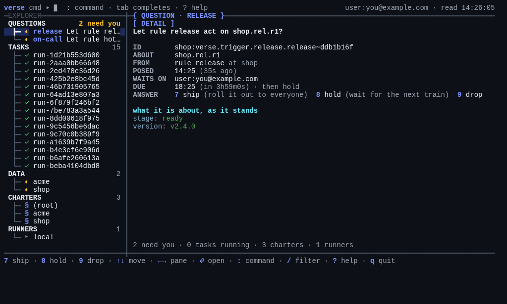
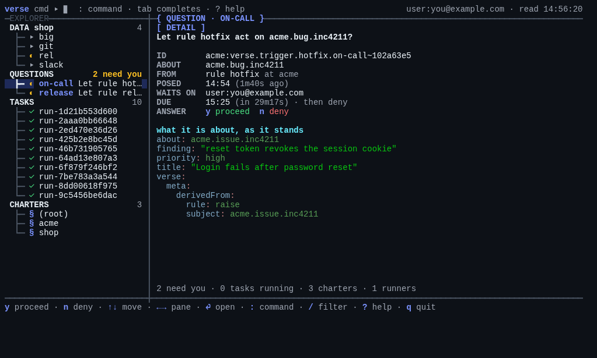

# Asking

`viff ask` asks somebody something. The ask goes to the people you name, with a date if you
give one. Their answer is written back on your ask, and what you said should follow that answer
runs for you. Every viff instance can ask: nothing has to be installed for it.

An ask is how anything in viff waits for a person. You raise one with `viff ask`. A rule's
gate raises one when it stops for a person. A task raises one with its `question-ask` tool and
waits on it, or with `viff-ask-create` as the person it runs for. All of them are the same
record, on one docket.

## The words

| | |
|---|---|
| **ask** | a record at `mirror.ask.<id>`: what is asked, of whom, by when, and what follows. `viff ask` writes yours, and its id comes from the name you give it |
| **asker** | whoever raised the ask: its record's `from`, `{principal: <you>}`. Your ask is your record |
| **to** | whom the ask is put to: a name or a list, in the [grammar a grant uses](perms.md#principals-and-grantees). Absent, anyone may answer. The record keeps it as `to: {grantees: […]}` |
| **due** | the date the ask settles at if nobody answers. Absent, it has no date and waits for an answer |
| **on silence** | the option the ask settles on at its date if nobody answers: `deny`, unless you say `--on-silence proceed` |
| **question** | an ask as the person asked sees it: one that waits on you. `viff question` lists them |
| **docket** | every pending ask you can read, whoever raised it and whoever it waits on. `viff question --all` lists it |
| **on** | what follows the answer: a list of rows, read in order. Each row is a `match` on the answer and a `then`. The first row whose match the answer meets runs its `then` ([what follows](#what-follows-the-answer)). Absent, or met by no row, the ask is a **vote** |
| **then** | what a row runs, as one key: `{spawn: {…}}` is a task, written as a charter's spawn is (`prompt` or `script`, `agent`, `environment`, `autonomy`, …) and meaning only what it says; `{answer: {ask: <id>, choice: <option>}}` answers another ask as you; `{ask: {…}}` raises another ask. `null` or `{}` runs nothing |
| **answer** | what is written back: `yes` or `no` |
| **ran** | what the row that met the answer ran: `{row, at}` and the task it started, the answer or ask it made, or why it failed |
| **edit** | which version of your ask an answer agreed to: 1 as first asked, and one more each time you change what it asks |
| **labels** | what the ask says about itself, for whoever watches asks: `--label team=payments,kind=deploy`. Viff routes nothing by them |

Every question on the docket, yours or not, says its parties the same way. `from` is who raised
it, exactly one of `{rule, at}` (a rule's gate, and the charter it is installed at), `{task}` (a
task's question), `{principal}` (an ask, or words said to a task: a person, an agent, or a
resolver acting as `via:…`) or `{principal, task}` (an ask a task raised as the person it runs
for). `to` is whom it is put to, `{grantees: […]}` or, for words said to a
task, `{task}`, and is absent where it names nobody. `by` is who settled it.

## Asking

```sh
cat > on.tony <<'EOF'
- match: {verdict: proceed}
  then:
    spawn:
      prompt: fast-forward main to ask-ui, run the tests, and push main
      environment:
        systems:
          network: {mode: open}
          commands: {}
          git:
          - repo: acme/app
            from: main
            fetch: {}
            push: {ref: refs/heads/main, force: false, delete: false}
      autonomy:
      - {match: {system: commands}, then: allow}
      - {match: {system: git, verb: fetch}, then: allow}
      - {then: ask}
EOF
viff ask land -q "Merge ask-ui into main of acme/app? No answer in 48h is a yes." \
  --to dana@example.com --due 48h --on-silence proceed --on @on.tony
```

`on.tony` has one row. Its match, `{verdict: proceed}`, meets a yes, and its `then` is what
follows: an agent given the prompt, in an environment that gives it the network, the shell, and
a checkout of acme/app that it may fetch and push to `main` without a rewrite. The autonomy runs the shell and the fetch unasked, and asks you before the push. A spawn
means only what it says: one that names no network has none, and viff checks it against the
runner it would run on when you ask, not after the yes.

`viff ask` answers with the ask's id: `land-` and a suffix. Commands take the name or the id.
If you have used one name for two asks, viff refuses the name and prints both ids, so you can
pick one.

The ask goes to Dana. It is on the docket, and in Slack where the deployment runs the Slack iod.
Dana answers it like any ask: `viff question <id> --answer proceed` for yes, or `deny` for no.
You do not answer your own ask, unless you named yourself in `--to`.

`--due` takes a date (`2026-10-02T17:00:00Z`) or a duration from now. If Dana answers yes, the
ask gets `answer: yes`, and the row's `then` runs as a task for you. A no gets `answer: no`,
meets no row, and runs nothing. No answer by the date settles on `deny`, unless you said
otherwise. Here silence means nobody objects, so `--on-silence proceed` makes silence a yes. You
choose it when you ask, and it stays when the date moves.

Leave out `--to`, and anyone may answer. Leave out `--on`, and the ask is a vote: the answer is
all it leaves.

A `then` that is a script runs exactly what it says, as `viff task run` runs one:

```sh
cat > release.tony <<'EOF'
- match: {verdict: proceed}
  then:
    spawn:
      script: |
        git -C app merge --ff-only mirror/main
        viff-call-tool git-push -repo app -branch release
      environment:
        systems:
          network: {mode: open}
          git:
          - repo: acme/app
            from: release
            fetch: {}
            push: {ref: refs/heads/release, force: false, delete: false}
      autonomy:
      - {then: allow}
EOF
viff ask release -q "Fast-forward release to main for v1.2?" --to dana@example.com --on @release.tony
```

The script fast-forwards the checkout's `release` to `main`, and the runner pushes it. A push is
the runner's act, with the runner's credential, so the script asks for it with
`viff-call-tool git-push`, and the `git` block gives that one push.

A prompt lets an agent choose its own actions, so that task's own rows ask you. A script is
what you wrote, so its autonomy lets it run as you wrote it.

A `then` may also answer another ask, or raise one, as you ([composing asks](#composing-asks)).

Viff checks what you give before it writes anything: the names, the date, that each `match` is
a pattern it can apply, and that each `then` is one key an ask can run. If it refuses, nothing is
written.

## What follows the answer

`on` is a list of rows. When the ask settles, viff reads the rows in order, and the first row
whose `match` meets the answer runs its `then`. No later row runs. A row with no `match` meets
every answer, so it belongs last. A row whose `then` is `null` or `{}` runs nothing, and the rows
after it do not run either.

The `match` is a tony match pattern, the one `viff data --if` takes. It is matched against the
answer as the ask's record holds it under `followed`:

| field | what it is |
|---|---|
| `verdict` | the option the ask settled on: `proceed` or `deny` |
| `by` | who settled it, or `deadline` where silence did at the date |
| `via` | the resolver or io the answer came through, where one did |
| `why`, `say` | the reason given and the words said with the answer, where there were any |

So `{verdict: proceed}` meets a yes, and `{verdict: deny}` meets a no, answered or by silence.
`{by: deadline}` meets silence alone, and `{verdict: !not proceed}` meets anything but a yes.
Rows can tell an answered no from silence:

```tony
- match: {verdict: proceed}
  then: {spawn: {…}}
- match: {by: deadline}
  then: {ask: {name: ship-lead, question: "Nobody answered: ship the hotfix?", to: [lead@example.com]}}
```

A yes runs the first row. Silence at the date runs the second. An answered no meets neither, so
it runs nothing.

## Composing asks

A `then` may be one more act of yours: an answer to another ask, or another ask. Viff makes it
as you when the answer meets its row. It gives you no right you do not already have. The answer
is only the condition.

**Your answer waits on somebody else's.** Alice asks you to ship the hotfix. You will say yes,
but only once Dana has looked at the UI:

```sh
# alice
viff ask ship -q "Ship the hotfix?" --to you@example.com
#   raised question ship-3f2a…: Ship the hotfix?

# you
viff ask ui-ok -q "Is the UI ok to ship?" --to dana@example.com --due 24h \
  --on '[{match: {verdict: proceed}, then: {answer: {ask: ship-3f2a…, choice: proceed, say: "dana checked the UI"}}}]'
```

When Dana answers `proceed`, viff answers `ship` with `proceed` as you, with your words, as if
you had answered it yourself. `viff ask ui-ok` says what happened:

```
answer: yes
…
ran:
  row: 0
  at: "2026-09-30T10:12:00Z"
  answered:
    ask: ship-3f2a…
    at: "2026-09-30T10:12:00Z"
    status: 204
```

Alice's `viff ask ship` reads `answer: yes`, and its record says it was answered
`by: user:you@example.com`. If Dana says no, or nobody answers by the date, nothing is answered,
and `ship` still waits on you. If `ship` needs two proceeds, yours is one ballot, and it waits
for another.

**Asks chain.** `{ask: {…}}` takes what `viff ask` takes (name, question, to, due,
onSilence, on, about, labels, keep), and raises that ask as you when its row is met. A `due`
that is a duration counts from the answer. Its own rows may answer or ask in turn. Here Dana's
yes asks Ann to deploy, and Ann's yes answers `ship`:

```sh
viff ask ui-ok -q "Is the UI ok to ship?" --to dana@example.com --due 24h \
  --on '[{match: {verdict: proceed}, then: {ask: {name: deploy, question: "Deploy the hotfix to staging?",
          to: [ann@example.com], due: 4h,
          on: [{match: {verdict: proceed}, then: {answer: {ask: ship-3f2a…, choice: proceed}}}]}}}]'
```

`viff ask ui-ok` then reads `ran: {row: 0, asked: {id: deploy-…}}`. `deploy` is your ask, to
Ann, due four hours after Dana's yes.

**Viff checks when you ask, and again when it acts.** When you ask `ui-ok`, viff checks that
`ship` exists, waits on you, and has a `proceed` option, and that Ann can read what `deploy` is
about. If any check fails, viff refuses the ask and writes nothing. When the yes comes, viff
makes the answer or the ask as you would make it at that moment:

- The answer is to `ship` as you saw it. If Alice changes `ship` before Dana answers, `ship` is
  asked again, and your answer to the old words is refused.
- If `ship` has settled in the meantime, there is nothing to answer.

What was refused, and why, is on your ask, under `ran`, as `answered` or `asked` with
`refused`.

**A no can run something too.** This is how you escalate. Ask Ann, and if she says no or nobody
answers in four hours, ask the lead:

```sh
viff ask ship -q "Ship the hotfix?" --to ann@example.com --due 4h \
  --on '[{match: {verdict: deny}, then: {ask: {name: ship-lead, question: "Ann said no, or did not answer: ship the hotfix?",
          to: [lead@example.com], due: 4h}}}]'
```

`viff ask ship` then reads `ran: {row: 0, asked: {id: ship-lead-…}}`. An ask withdrawn before
anybody answered runs nothing. The message in Slack shows each row: what it meets, and what it
runs.

## How long it stands

An ask that has settled, answered or not, stays for a week and is then removed. That holds for
every ask on the docket, whoever raised it. For your own ask, `--keep 72h` sets another time.
`viff ask` shows when it goes, as `expires`. A task its row started stays as tasks do.

An ask settles once, on the first answer that settles it. Viff writes that answer on the ask as
`followed` before the row it meets runs, and before whoever asked hears it. So what runs,
what the asker hears and what the ask says are that one answer's. An answer that lands after it
is refused, and the refusal names whose answer stands. If the answer cannot reach whoever waits
on the ask, `followed` says why, as `undelivered`. The answer still stands: it reaches them when
the ask is asked again, and answering it again meanwhile says `the answer stands`.

If a rule's gate fires again after its ask settled, it raises a new ask with its own id. The
settled ask keeps its answer until it goes. An ask that is asked again while it still waits,
because a restart or a lifted suspension brings its gate back, is not removed: it stays while it
waits.

## Who reads it

You read your ask, and so do the people it asks. Nobody else does. An ask that names nobody,
which anyone may answer, is read by everyone.

An ask `--about` something is read by whoever may read that thing instead. If it also names
nobody, whoever may write that thing may answer it. You, and everybody you ask, must be able to
read what the ask is about, or viff refuses it.

## Following your asks

```sh
viff ask                # your asks: the question, who is asked, the date, the answer or pending
viff ask land           # one of them, and whom it waits on
viff ask --watch        # a line for each event, until stopped
```

An ask that settles with nobody to answer it, because viff could not put it to whom it names,
has no answer: it shows its `status`, `orphaned`, and `why`.

`--watch` prints a line when an ask of yours is asked, asked again, answered or withdrawn. Each
line starts with its revision. Pass the last one you saw as `--since` on the next run, and
viff replays what happened in between. The store can replay for as long as it keeps its full
log: an hour by default (`viff up --logd-config` changes it).

What others ask of you is the other side, `viff question`:

```sh
viff question            # the asks waiting on you, that you did not raise
viff question <id>       # one of them, with its options and ballots
viff question --watch    # a line when one starts waiting on you, and when it settles
```

`viff question` leaves out an ask that a resolver answers for you; `--served` adds it
([resolvers](attached-resolvers.md)). `--all` lists the whole docket. `viff question --watch`
takes `--since` as `viff ask --watch` does.

Either watch takes `--notify` to say what needs you on the desktop too: a question that starts
waiting on you (urgent, so it stays until you dismiss it where the desktop keeps such ones), and
an ask of yours answered. A question that settles closes its notification rather than adding one;
the watch's line says how it settled. What stands when the watch opens, or what `--since` and a
reconnect catch up on, is one quiet summary ("2 questions wait on you"), not a notification each; the summary
is closed once every question it counted has settled.

On Linux and the BSDs it goes to the notification service on the session bus
(`org.freedesktop.Notifications`, which GNOME, KDE, dunst, mako and swaync serve), with a
question's text escaped where the service reads markup. On macOS it goes to Notification Center
through `osascript`, which attributes it to Script Editor: allow Script Editor under System
Settings › Notifications, or nothing appears. With no such service the watch refuses to start. A
desktop that refuses or falls behind is said once, on a line; the lines are the same either way.

```sh
viff question --watch --notify
```

`viff tui` shows the same questions in a terminal screen, beside the tasks, the data, the
charters installed and the runners. `a` proceeds, `d` denies and asks why, `7`-`9` choose a
question's other options and `:answer <option>` any of them. A question shows who asks, a
task's step and its fields, who may answer and when it settles, and its subject as it stands,
so a merge gate shows the step it would merge.



The screen is two panes under a command line. On the left, the explorer lists each section
with its rows under it. On the right, the content shows a section as a table, or the row the
cursor is on. `:` takes a command by name (`:tasks`, `:data repos.viff`, `:view timeline`),
and tab completes it. `?` lists every command and key. A pane that holds more than it shows
says where it is (`1-40 of 97`), and `J`/`K` scroll it.

A task under the cursor shows its record, and `tab` or `:attach` shows its transcript
instead: what the agent says, each action it takes and what came of it, and the questions it
stops on, as `viff task attach` streams them. A running task's transcript is followed; the pane
stays on the last line until it is scrolled up.

A charter under the cursor shows its record, and `tab` shows it as a graph: each place its
rules watch, the rules on that place under it, and the places a rule derives into under the
rule. A rule's line says what it does and names its gates, then counts its work in the
runtime: the tasks running, the questions its gates wait on, and how its other tasks ended.
The tasks running and the questions waiting are listed under the rule. The graph is drawn from
what every charter says of itself and from the names the engine gives a rule's tasks
(`<charter>:<rule>@<subject>`), so it draws any charter and knows none.

`:graph`, or `tab` on the Tasks section's own line, shows everything in flight that way: each
charter with a task running or a question waiting as its graph, then the tasks run by hand,
the questions no rule's gate posed, and a line for each charter whose tasks have all ended.
Another `tab` puts the tasks running, and those that ended in the last half hour, on one
timeline.

The Data section browses the viff instance an address at a time, and knows no charter. It lists what
is under an address (the root, or `--at <address>`); `⏎` opens a place into what is under it,
and `u` goes back up. The place under the cursor shows its record, the rule and subject it was
derived from where a rule derived it, and the questions and tasks about it. `tab` shows those
tasks on a timeline. The Charters section lists each address a charter is installed at, with
its rules, schedules and sends.

The screen reads the `tui:` section of viff's config (`~/.config/viff.tony`). There you can
set how often it reads, where it opens, which sections it shows and in what order, names for
places in the data (`:go <name>`), and which keys do what.
[The example](reference/examples/tui/viff.tony) sets each of them. A key is bound to an
action by name, such as `answer.proceed: [y]`, and `[]` leaves an action unbound. Keys are
spelled as the terminal reports them: `ctrl+d`, `pgdown`, `shift+tab`, `space`, `G`. A bookmark's
name is letters, digits, `-` and `_`. A mistake stops the screen from starting and says what is
wrong: a field that is not one, a key bound to two actions or spelled as no terminal sends it, an
unknown section, a bookmark that is not an address, or a config file that did not load. `viff tui --config` prints the section as in force, with
every key, ready to paste; `viff tui --commands` lists every command and action.



## Changing your mind

While an ask waits, you can change it, or take it back:

```sh
viff ask land --due 72h                               # move its date: nothing is asked again
viff ask land --on @on.tony                           # change what follows: it is asked again
viff ask land --to peggy@example.com                    # ask somebody else: asked again, of them
viff ask land --withdraw                              # take it back
```

An answer agrees to what was asked, not to when. So a new date moves the clock and keeps any
answer already given. A new `--on` or a new `--to` changes what is asked, so the ask is asked
again as its next **edit**. Answers to the earlier edit do not count, and an answer that names
that edit is refused. So nobody answers words they were not asked.

Withdrawing an ask takes it off the docket and removes it. Nothing is written on anybody's
behalf.

Once an ask has an answer, it does not change, even before the answer reaches you. Anything more
is a new ask.

In Slack, the message says who asked and what each row runs, and a reply answers that edit. The
message is drawn again when the ask changes. A reply to the old words is refused. A reply to the
new message answers what it now says.

## Whose authority what follows runs with

Yours alone. You raised the ask, so what follows it is yours to answer for. Ask Dana "may I merge this?", and her yes lets you merge what you may merge. Dana does not
need that right. The task is your record, so its own gates ask you.

Nobody but you writes your ask. It is yours, and nobody owns a place above it.

What follows runs before your wait is released, and a spawn has run once it is launched.

A task's `viff-ask-create` is your ask too, when the task runs for you. Its rows run with your
authority, so a spawn in any of them is held within the task: its environment no wider than the
task's, less installing charters (`viff.charter-install`), its autonomy no looser, on the
task's runner, spending the task's credential where it spends one (a script spends none). The
same holds for an ask a row raises, and for its rows. An answer in any of them is refused: it
would be yours, on any ask that waits on you, another task's gate among them. A task cannot
raise past what you let it do. Once raised, the ask is yours to change as any of yours.

Only an ask has an `on`. You need not be there when the answer comes, so the ask carries what
follows it. A rule's gate has none: what a rule does about a yes is its action
([gates](reference/gates.md#ondenied-what-a-no-means)). An autonomy row's ask has none either:
the task waits on it, and what the task does about a yes is the step it asked about
([tasks](reference/tasks.md#the-autonomy)).

## Saying something to a running task

Words you say to a running task are an ask to the task:

```sh
viff task say run-7 "use the staging bucket"     # said to run-7: say-3f2a…
viff ask say-3f2a…                               # answer: heard, once the task has taken them
```

The ask is yours, about the task, and whoever may read the task may read it. It has no date: a
turn in a conversation has none. If the task is waiting for your turn, the words are your
reply, and the turn is answered. Otherwise the task takes them at its next boundary, and the ask
settles as `heard`. If the task ends before it takes them, the ask is withdrawn, and says so.
Words to a task on a remote runner are heard when viff passes them to the runner.
`viff flow say` says the words to each task the flow reaches, as one ask to each.

Nobody else answers these asks, so they are not on the docket.

## Where the rest is

- [Gates](reference/gates.md): how a rule raises an ask, and who may answer one.
- [A question for the person](reference/tasks.md#a-question-for-the-person): how a task raises
  one, with a clock of its own (`within`, `default`) or none.
- [Permissions](reference/perms.md#questions): who reads and who answers an ask.
