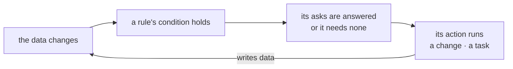

# Basic concepts

Viff watches the systems a team's work lives in, and when something there changes, it does what
the team's rules say. This page names the four things you work with, then the parts of viff that
run them.

One example runs through the page. A team keeps its code in `acme/app` on GitHub. When the checks
on a pull request fail, the team wants an agent to make them pass. When they pass, the pull
request is merged into `main`, but only once a person says yes.

## What you work with

| Term | What it is | In the example |
|---|---|---|
| **data** | what viff knows about the world, each piece at an address | `github.acme.app.pr.42`: pull request 42 as GitHub last reported it, `{state: open, checks: failure, …}` |
| **charter** | your rules: when the data changes like this, do that | when an open pull request's checks fail, start an agent on it; when they pass, merge it |
| **task** | work done in the world by an agent or a script | the agent checks out the pull request's branch, makes the checks pass, and pushes the branch |
| **ask** | a question put to a person, which a step waits on | the merge into `main` waits for dana to answer yes |

**Data.** The systems viff watches write their state into it, and so do your rules and tasks.
Every write says who made it. You read the data with `viff data` and follow its changes with
`viff watch` ([data](tutorial/data.md)).

**Charter.** A charter is a file of rules. Each rule has a condition on the data and an action:
change the data, or start a task. You install a charter with `viff charter -a`
([charters](tutorial/charters.md)).

**Task.** A task runs on a runner, which holds the credentials for the systems the task uses.
Its environment says which systems and repositories it may reach, and its autonomy says which of
its steps go ahead and which ask first. You watch and steer tasks with `viff task`
([tasks](reference/tasks.md)).

**Ask.** An ask goes to the people it names, and they answer from the CLI, Slack or a pull
request. A deadline can settle it when nobody answers. `viff question` lists what waits on you,
and `viff ask` puts a question of your own, with what to do on a yes ([asking](asking.md)).

## The loop

Viff writes the state of each task into the data. So a task that ends is a change, and it can
start the next rule. In the example, the agent's push changes the pull request's head, GitHub runs
the checks again, and the new result arrives as data. Now the checks pass, so the merge rule
holds, and it asks dana. A flow of several steps goes on like this, through the data, not through
a scheduler.

## What viff is made of

| Part | What it does |
|---|---|
| **the store** | keeps the data, one shared log for the whole team. Every commit has a revision and an author, and anyone may watch it. |
| **iod** | connects one outside system to the store. `iod github` writes `acme/app`'s pull requests and workflow runs as data, and carries back to GitHub what a rule writes for it, such as the merge. |
| **runner** | runs tasks, on a machine of your choosing. It holds the credentials, and makes each call a task asks for within its ceiling. A task holds no credential. |
| **principal** | whoever acts: a person, a runner, an agent, or viff itself. |

**Everyone acts under their own name.** One viff is shared by a team. Each write, task and
answer records who made it. Each place in the data has one owner, and anybody else acts on it by
a grant the owner writes. A charter acts as the person who installed it, and reads only what they
may read ([permissions](perms.md)).

**An outside system has two faces.** A charter sees what an iod reflects into the data. A task
calls the system's verbs, such as `git.push` or `github.create-pr`, through its runner
([systems](systems/README.md)). Viff itself is one such system: a task can read the data, raise
asks and install charters as the person it runs for ([the viff system](systems/viff.md)).

**What changes, and what is allowed, are kept apart.** The data says what the world last looked
like. Gates, asks and permissions say what may happen. A stream of changes never stands in front
of an answer or a stop: you can always halt a flow in time with `viff flow`, whatever is arriving
([control](control.md)).

[The glossary](glossary.md) defines every other term the docs use.
