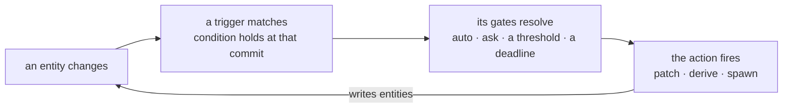

# Basic concepts

This page has four terms, the loop they run in, and the model behind them. Every other page
uses these words.

## Four things to know

| Term | What it is | For example |
|---|---|---|
| **entity** | a fact verse keeps about the world, with an address and a value | `github.signadot.verse.pr.42`, the pull request as GitHub last reported it |
| **charter** | your rules: when an entity changes like this, do that | "when main moves, review what landed" |
| **task** | work done in the world by an agent or a script, on a runner | an agent fixes the comments a review found, in its own checkout |
| **gate** | a check a step passes first: `auto` passes it, `ask` waits for somebody | "merge to main" waits for one yes within a day, or is denied |

The rest of the docs is detail about these four.

## The loop

Verse writes the state of each task into the store. So a task that ends is a change to an
entity, and it can cause the next reaction. A flow with several steps continues this way:
through the store, not through a scheduler.

## The model

| Term | What it is |
|---|---|
| **entity** | anything the work refers to: a pull request, a build, a person. It has an address and a payload. |
| **store** | the shared log of entities, one for the whole team. Anyone may watch it, and every commit has a revision and an author. |
| **trigger**, or **rule** | one rule of a charter: when the condition holds and the gates pass, the action fires. |
| **gate** | what a firing must pass: `auto` or `ask`. |
| **action** | what a rule does. It is data, not code. |
| **task** | a unit of work that verse governs and that you can steer. An agent, a script or a remote worker does it. |
| **principal** | who acts: a person, a runner, an agent, or the system. |
| **subject** | the entity a piece of work is about. |
| **flow** | the tasks in progress about one subject, or about the subjects a pattern names. |

An **entity** has an address, such as `demo.pr.1`, `github.signadot.verse.pr.42` or
`verse.task.instance.review-1`. Its payload is any value.

A **rule** has a `condition`, a list of `gates`, and an `action`. The condition names the
`subject`, which is required. It may also name a cause, `on`, or something that must hold,
`when`. Every gate must pass. [The charter reference](trigger-model.md) has the model in full.

A **gate** has one of two modes:

| Mode | What happens |
|---|---|
| `auto` | the action fires |
| `ask` | a person or an agent must say yes first |

An **action** can do four things, and one action may do several of them:

| Field | What it does |
|---|---|
| `patch` | changes the payload of the subject |
| `derive` | writes another entity from the subject |
| `spawn` | starts a task |
| `seq` | runs a list of actions in order |

An action acts on the subject of its condition, and names no other target. It can read
`$subject`, and every field of the subject's payload.

A **task** runs on a runner. You can watch it and steer it. A task is also an entity,
`verse.task.instance.<id>` ([the mirror](glossary.md#mirror-of-tasks)).

A **principal** is a person by email, a runner by its name, an agent, or the system, which is
verse itself. Every request and every firing writes as a principal.

A verse is one shared space. Every person on the team, every runner and every agent acts in it
under their own name, so the record of a task or of an answer says who, and the permissions say who
may read what and who may steer it. Nothing in verse is one person's process: a task a colleague
started is on your `verse task` too, if you may read it, and the question it asks waits on whoever
it names.
Every node in the store has one owner. Anybody else acts on it by a *grant* that the owner
writes. A charter acts as its owner, and reads only what its owner may read.
[Permissions](perms.md) has the model.

A **subject** and a **flow** are derived. Verse keeps no record of either. A subject, such as a
pull request on its way to merge, is part of nearly every id verse keeps: the id of a spawn, the
id of a gate's question. A flow is built each time you ask for it, and you steer it as one unit.

## An outside system has two faces

Verse meets each system outside it, such as a repository, an issue tracker, GitHub or Linear,
in two places:

| Face | Who uses it | How |
|---|---|---|
| **reflected** | charters | an [iod](glossary.md#iod) writes what the system holds into the store as entities, and a rule reacts to them. What a rule writes back, such as a comment or a tag, goes out to the system through the same iod. |
| **called** | tasks | a task calls the system's verbs, such as `git.push` or `linear-issue.create`. The task's [environment](glossary.md#environment) gives it, and its [autonomy](glossary.md#autonomy) decides each call. The runner makes the call with a credential the task never holds, within the runner's [ceiling](glossary.md#ceiling). |

Verse describes each system once, as a document that names its verbs and what each verb is
about. [Systems](systems/README.md) has a page for each.

## Two planes: what changes, and what is allowed

Verse keeps two things apart:

| Plane | What is on it | How you see it |
|---|---|---|
| **observation** | what the world last looked like: every entity the iods wrote, and the state of every task as it runs | `verse data`, `verse watch`, `verse task` |
| **control** | what may happen: the gates a rule or a task must pass, who may answer them, a hold on one run, a suspension of the work about a subject, and who owns what | `verse question`, `verse flow`, `verse perms` |

Observation never decides anything, and control never waits behind the stream of changes. So
you can always stop a flow in time, whatever is arriving. And a task's own account of what it
did never decides who answered a question about it.
[architecture.md](platform/architecture.md#observation-and-control-are-separate-planes) says how
the two are built.
