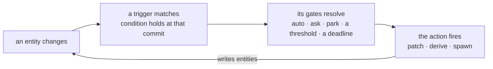

# Verse

Verse is a small runtime. It governs software delivery work across systems it does not own,
and you choose how much of that work agents do without asking.

You install a *charter*, which is a list of rules. Verse reacts to changes in a shared store
of entities and does the work with agent tasks. Every reaction passes a gate: `auto`, `ask`
or `park`. You set the gate for each action.

Read this page first, then [the tutorial](tutorial.md). [The glossary](glossary.md) defines
each term once. The page assumes you know Go, HTTP,
and three ideas from distributed systems: a cursor into a log, compare-and-swap, and
at-least-once delivery.

## Verse and workflow engines

You do not write a workflow in verse. This is a constraint first, and a feature second.

Verse works with things it does not own: a repository, a chat workspace, a person's time.
Verse can *observe* them, and it can *request* that they change. It can do nothing else.

A workflow keeps a position in a plan. That position is a second statement about the state of
those things, and it is wrong as soon as one of them changes between two steps. So verse keeps
no plan. It reacts to what it last observed. Everything on this page follows from that.

## The loop

Verse writes the state of each task into the store. So a task that completes is an entity
change, and it can cause the next reaction. This is how a flow with several steps continues:
through the store, and not through a scheduler.

## The model

| Term | What it is |
|---|---|
| **entity** | anything the work refers to: a pull request, a build, a person. It has an address and a payload. |
| **store** | the shared log of entities. It can be observed, and every commit has a revision. |
| **trigger**, or **rule** | one rule of a charter: when the condition holds and the gates resolve, the action fires. |
| **gate** | what a firing must pass: `auto`, `ask` or `park`. |
| **action** | what a rule does. It is data, not code. |
| **task** | a unit of work that verse governs and that you can steer. An agent, a shell command, a worker or a person does it. |
| **principal** | who acts: a person, a runner, an agent, or the system. |
| **subject** | the entity a piece of work is about. |
| **flow** | the tasks in progress about one subject, or about the subjects that a pattern names. |

An **entity** has an address, such as `demo.pr.1`, `github.signadot.verse.pr.42` or
`verse.task.instance.review-1`. Its payload is any value.

A **trigger** has a `condition`, a list of `gates`, and an `action`. The condition names the
`subject`, which is required. The condition may also
carry a `when`, for the case where the cause is not the subject itself. A `when` is a match at
one point in time, over an address and a predicate on the payload. All the gates must pass.
See [the trigger model](trigger-model.md).

A **gate** has one of three modes.

| Mode | What happens |
|---|---|
| `auto` | the action fires |
| `ask` | a person or an agent must approve first |
| `park` | the action is held |

An **action** can do four things, and one action may do several of them.

| Field | What it does |
|---|---|
| `patch` | changes the payload of the subject |
| `derive` | writes another entity from the subject |
| `spawn` | starts a task, from a `launch.Spec` |
| `seq` | runs a list of actions in order |

An action acts on the subject of its condition, and names no other target. It may use
bindings: `$subject`, and every field of the changed payload.

A **task** runs in a runtime. You can observe it and steer it. A task is also an entity,
`verse.task.instance.<id>` ([tasks are entities](#tasks-are-entities)).

A **principal** is a person by email, a runner under its own name, an operator agent, or the
system, which is versed itself. Every request and every firing writes as a principal.

Every node has one owner. The owner is fixed when the node is created: it is the creator, or
the owner of the node above. The owners of the nodes above are co-owners. Anybody else acts on
a node by a *grant*, which the owner writes on the node's record. What a new node grants comes
from a default on the record above it.

A charter acts as its owner, and reads only what its owner may read. A question is answered by
the owner of what asked it, and by whoever the question was held out to. See
[permissions](perms.md).

A **subject** and a **flow** are derived. Verse keeps no record of either.

- A subject, such as a pull request moving through its lifecycle, is half of nearly every
  identity verse keeps: the id of a spawn, the question of a gate, the cover of a resolver.
- You steer a flow as one unit. Verse builds the flow each time you ask.

## How verse is built

Verse is a set of parts: the store, the engine that reacts, the task runtime, and the server.
How the parts work, and how verse handles data and failure, is in
[architecture.md](platform/architecture.md), in the repository.

## Design decisions

### Observation and control are separate planes

Steering never waits behind the stream of changes, so you can always stop a flow in time. How
the two planes work is in [architecture.md](platform/architecture.md#observation-and-control-are-separate-planes),
in the repository.

### Actions are data

The action of a rule is a declaration, such as a `patch` or a `spawn`. It is not a callback.
So you can inspect a charter, compare two versions of it, and install it while verse runs.
The `when` of a rule is kept small, because a large condition is hard to reason about.

### No orchestrator

Verse observes and requests. It has no position in a plan to keep, so an orchestrator has no
place in it.

Nothing sequences "review, then reviewed". The review task completes, and that is a change to
a `verse.task.instance` entity. Then one of two things reacts to the change and advances the
subject: the rule's own `onDone` hook, or a separate rule. Rules compose by reacting to shared
state. This is why verse can run many independent flows at once with no central plan.

A rule must opt in to match `verse.task.*`, so the loop cannot start from verse's own records
by accident.

With no plan to read, a flow is derived and not stored. `verse flow show <subject>` builds the
flow for one subject from three sources.

| Source | What it says |
|---|---|
| the charter | what may still happen |
| the mirror | what has already happened |
| the live registry | what is running now |

No one of the three is enough alone. This is why none of them is the plan.

### Tasks are entities

Verse mirrors the state of a task into the store. Three things follow:

- you observe every task by watching `verse.task.instance.*`;
- a task that completes is an ordinary change event;
- the outcome of a task outlasts the runtime that ran it.

### A gate goes up

An executor may reach a decision that it is not allowed to make. It does not decide. It
raises a gate to versed. Verse governs who answers: nobody (`auto`), a person, an agent, a
vote with a threshold, or a resolver.

An executor never answers its own gate. Governance stays on versed's side.

## Data and failure model

When verse restarts, it attaches again to a task that runs outside the verse process. A task
whose runtime was in the verse process ended with it, and verse marks the task `orphaned`. How
verse handles data and failure is in
[architecture.md](platform/architecture.md#data-and-failure-model), in the repository.

## Where to go next

[The tutorial](tutorial.md) starts from nothing and ends with a flow that runs by itself and
that you can steer. [The docs index](README.md) groups the other pages by who reads them.
