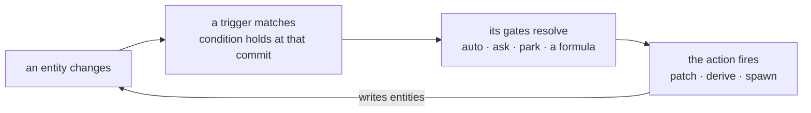
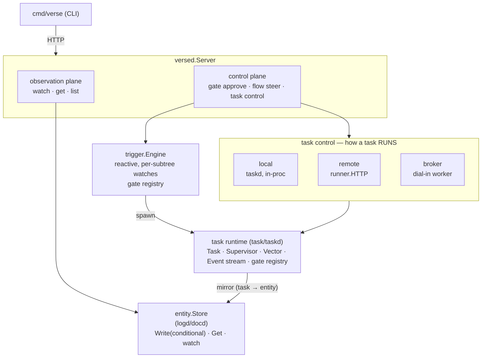

# Verse

Verse is a small runtime for governing SDLC work across systems it does not own, on a dial of
agentic autonomy. You install a *charter* of trigger rules. The runtime reacts to changes in a
shared, observable entity store and does the work with governed agent tasks. Every reaction
passes a gate: `auto`, `ask`, or `park`. Autonomy is set per action.

Read this first, then the deep-dives indexed in [the docs index](README.md). It assumes Go,
HTTP, and the usual distributed-systems ideas: cursors, CAS, at-least-once delivery.

## Verse and workflow engines

You do not author a workflow, and that is a constraint before it is a feature. Verse can
*observe* a repository, a chat workspace, or a colleague's afternoon, and it can *request* that
they change. It can do nothing else. Sequencing would mean holding a position in a plan, and a
position is a second claim about state verse does not own: wrong the moment the world moves
between two steps. What remains is reacting to what was last observed. Everything below follows
from it.

## The loop

A task's state is mirrored into the store, so a task completing is itself an entity change and
can trigger the next reaction. That is how multi-step flows close: through the store, not
through a scheduler.

## The model

An *entity* is anything the SDLC refers to. It has an address (`demo.pr.1`,
`github.pr.org/repo#42`, `verse.task.instance.review-1`) and an arbitrary payload value. The
entity store is the shared, observable, cursored log of these.

A *trigger* is one charter rule: when the condition holds and the gates resolve, an action
fires. The `condition` names the required `subject` the firing is about, plus an optional `when`
for the case where the cause is not the subject itself: a point-in-time match over an address
and a payload predicate, or a temporal formula. `gates` is a conjunctive list. See
[the trigger model](trigger-model.md).

A *gate* is `auto` (fire), `ask` (a human or agent must approve), or `park` (hold). This is the
autonomy dial, expressed per action.

An *action* is data, not code: `patch` an entity's payload, `spawn` a task from a `launch.Spec`,
or both. It acts on the condition's subject and carries no target of its own. Template bindings
parameterize it: `$subject`, and every field of the changed payload.

A *task* is a governed unit of agentic work, hosted by a runtime, observable and steerable.
Tasks are entities (`verse.task.instance.<id>`), so the fleet is visible by watching the store.

A *subject* and a *flow* are derived, and *derived* is meant literally: neither is a record
anything keeps. A subject is the entity a piece of work is about, the PR moving through its
lifecycle. It is what a rule's condition selects, and half of nearly every identity in the
system: a spawn's id, a gate's question, a resolver's instance. A flow is a subject's in-flight
tasks, steerable as a unit, assembled per request.

## Components

`verse up` assembles these in one process. Each is a package behind an interface, so they
separate into services without changing callers.

`entity` is the store. It has one write: a value merges in at a place, a whole entity or one
field inside it, if every precondition holds, checked with the write in a single step. Creating,
updating, patching a field, removing one, and claiming an address are that call with different
arguments, and `entity.Modify` builds compare-and-swap out of it. `Get` reads a ref and `List`
enumerates. `Observe` is a low-latency hint that may drop; the cursored `watch … since=<rev>`
replay is the source of truth, and every event carries the entity as of its commit. logd/docd
gives durability, copy-on-write scopes, and controller federation. See
[change events](change-events.md).

`trigger` is the reactive engine. It observes the store through per-subtree watches, matches
installed `Def`s, resolves gates through a shared registry, and fires actions. Each trigger
watches exactly the `system.kind` it matches, and there is no root watch. A spawn goes through
the engine's `Spawner`, which hosts the task via task control and mirrors it back.

`task` and `task/taskd` are the task runtime. A `Task` runs a driver (`Next() → ToolUse`:
`scripted`, `calls` or `llm`) under a `Supervisor` governed by a `Vector`, the per-task autonomy
defaults. It emits a cursored, ring-buffered, resumable event stream and posts gate decisions to
a registry. `taskd` is the HTTP daemon face of that runtime.

`mirror` projects a task's ephemeral read plane onto its durable `verse.task.instance.<id>`
entity: status, a `say` preview, last tool output, final `result`, the resume `cursor`, the
`runner`, and a broker's `dialURL`. It is one-way, and an index rather than a warehouse. An id
names the work rather than the run, so a re-fire reuses it and the instance holds the latest run.
Each run also writes `verse.task.run.<id>@<occurrence>` (see [tasks](reference/tasks.md)). Ask the
instance what the work is doing; ask the runs what happened the other times.

`versed` is the assembly and the HTTP surface. It owns scopes, which are per-scope engines over a
copy-on-write store view, hosts brokers under `/broker/<nonce>`, and runs resume-or-orphan
reconcile at startup. `runner` and `broker` are the two off-box task-control backends, described
below.

`source` federates external state in. `verse connect` reflects a working tree into a scope,
writing file metadata as entities and serving contents on demand through a docd controller, and
the same pattern generalizes to git, GitHub and the rest. See [connect](working/connect.md),
[sources](sources.md), and [content federation](content-federation.md).

## Design decisions

### Reactivity rides a durable, cursored store

The store is the truth and the change stream is a cursor into it. `Observe` may drop under load,
because it is a doorbell. Correctness comes from replaying `since=<rev>`, so a long hold costs a
cursor rather than a buffer. A contended write states its precondition and the store checks it
with the write. This is what lets the engine, a restart, or a second reader converge without
coordination.

### Observation and control are separate planes

Reads can lag. Steering (`gate approve|deny`, `flow pause/cancel/say`) is out-of-band and
serviced ahead of observation, never riding the change stream. An intervention that queues behind
a backlog of observations is an intervention defeated, so a runaway flow can always be stopped in
time. See [deployment and steering](deployment-and-steering.md).

### Actions are data

A trigger's action is a declarative `patch`/`spawn`, not a callback. The charter is inspectable,
diffable, and installable at runtime. The "when" is kept small, because that is where complexity
hides.

### No orchestrator, because there is nowhere to put one

Verse observes and requests, so there is no position in a plan for it to hold. An orchestrator is
a component with nowhere to live rather than a component left out.

Nothing sequences "review, then reviewed." The review task completing becomes a
`verse.task.instance` change, and either the trigger's own `onDone` hook or a separate `reviewed`
trigger reacts to it and advances the subject. Composition is triggers reacting to shared state,
which is why the model scales to many concurrent, independent flows with no central plan.
Triggers must opt in to `task:*` matches, so the loop cannot ignite on its own machinery.

With no plan to read, a flow is derived rather than stored. `verse flow show <subject>` assembles
a subject's shape per request by joining the charter (what may yet happen), the mirror (what
already did) and the live registry (what is running). No one of the three is sufficient, which is
why none of them is the plan.

### Tasks are entities

Because `mirror` projects the read plane into the store, the fleet is observable by watching
`verse.task.instance.*`, completions are ordinary change events, and a task's outcome survives
its ephemeral runtime.

### How a task runs is a seam

`task.Runner{Spawn, Attach, Ref}` returns a
`task.Handle{Subscribe, Pause/Resume/Cancel/Steer/SetVector/Result}`. The engine drives every
task through that handle and never touches the runtime directly. There is no privileged local
path. Three implementations sit behind it:

- *local* — the in-process `taskd` supervisor, reached by a Go call.
- *remote* — `runner.HTTP(baseURL)`, driving another verse or host over the verse-facing
  contract: `GET /tasks`, `GET /events?since`, and control POSTs.
- *broker* — a task whose runtime is an external dial-in worker: a laptop agent, a firewalled
  pod, or a human. The worker connects out to the broker (`claim`, `inbox`, `report`), and the
  broker glues that leg to verse's handle. It is the `task.Handle` turned inside-out: the same
  task behind two handles, one where it runs and one where it is observed.

Because the seam is uniform, `verse task get/attach/cancel/say/approve` works whether a task is
local, remote, or brokered, and a human executes a task via `verse task do` exactly as an agent
would. See [task control](task-control.md).

### Gates are the dial, and they point up

An executor that reaches a decision it is not authorized to make raises a gate to versed rather
than deciding, and the verse governs who resolves it: auto, a human, later a vote or a reviewer.
The executor never resolves its own gate. Governance stays on versed's side of the mirror.

## Data and failure model

*Addresses and cursors.* An address is a path in a tree, at any depth, and it carries on into the
payload: `demo.pr."1"` names an entity, `demo.pr."1".labels.urgent` a place inside one, and
`verse-dev.drift.head.abc` an entity a package derived four segments down. Three segments is the
ordinary DEPTH rather than the shape — it is what a listing counts to find the entities under a
prefix, and it is four in verse's own half, where the reserved root is a level like any other.
[entities](reference/entities.md#addressing) is the grammar, in both its spellings. A store
revision is monotonic but sparse, and is treated as an opaque cursor. The task event stream
carries its own per-task cursor for resume. Nothing assumes dense numbering, and everything
reconciles via `since`.

*Scopes.* A scope is a copy-on-write overlay: reads see the scope layered on baseline, writes land
in the scope only. Local-dev federation and a dev's in-flight flows live in a private scope,
isolated from baseline and from other devs, and dropped in one `DeleteScope`.

*The charter is durable.* An installed trigger is an entity (`verse.trigger.rule.<name>`) carrying
the definition it was installed from, so a restart reinstalls the rules standing in the verse
before anything observes. Restoring replays, exactly as installing does, so a change that arrived
while verse was down is acted on. See
[the trigger model](trigger-model.md#the-charter-is-durable).

*Resume, not orphan.* On restart, `versed.reconcileTasks` re-attaches a non-terminal task whose
work outlived verse, such as one on a remote runner, replaying to recover a terminal reached while
down. It orphans one whose in-process runtime died with the previous run. Open gate questions
follow their asker: a resumed task keeps its docket entries answerable, and an orphaned one's are
settled off the docket.

*CAS at every contended write.* A store write carries its preconditions, checked with it in one
step (docd's `PatchIf`). A broker adds two more: a terminal-once latch, where the first terminal
writer wins and post-terminal reports are frozen idempotent no-ops, and a claim fence, where each
claim mints an epoch and a stale generation is rejected. A displaced or zombie worker cannot
corrupt the log.

## Extension points

- *Driver* — how a task thinks: `scripted`, `calls`, `llm`, or your own `Next`.
- *Task control* — where and how a task runs: a k8s Job, a lambda, a broker for humans.
- *Store* — logd/docd, or anything implementing the `Store` interface.
- *Source* — reflect an external system into an owned slice of the verse, as a program you deploy
  and install ([sources](sources.md)). Distinct from a *docd controller*, which serves bytes
  somebody asks for rather than facts something reacts to
  ([writing a controller](controllers.md)).

## Deployment

`verse up` runs the engine, task runtime, and HTTP surface in one process, and either brings up
logd and docd as children or attaches to a running docd. The pieces — store, engine (`versed`),
task runtime (`task`) — are separable services behind these same interfaces, and task control
already lets tasks run off-box.

Which of the seams can be a *wire*, and which side opens the connection, is [seams](seams.md).
Which side opens it decides what each seam is good for, and why two seams carrying nearly the
same payload in opposite directions both have to exist.

## Where to go next

[The tutorial](tutorial.md) takes you from zero to a running, steerable, self-driving flow.
[The docs index](README.md) pairs each of its sections with the notes behind that subject.
