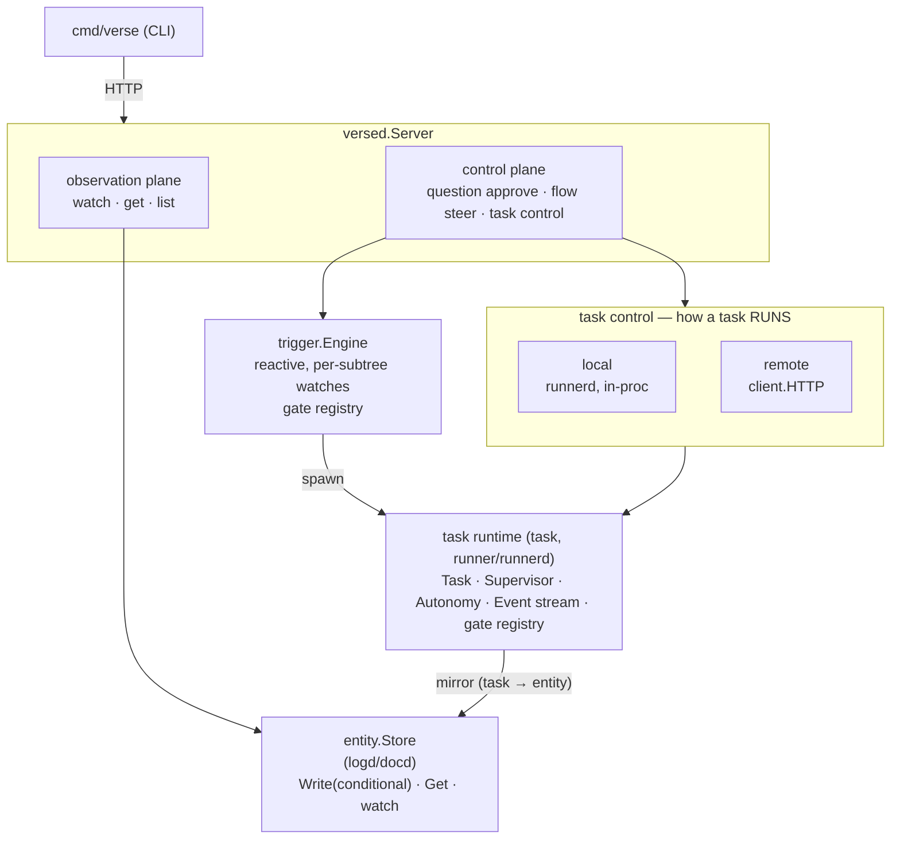

# Architecture

This page describes the parts of verse, how they fit together, and how verse handles data and failure.

## Components

`verse up` runs these in one process. Each is a package behind an interface, so each can
become a service of its own without a change to its callers.

**`entity`** is the store. It has one write. A write merges a value in at a place, which is a
whole entity or one field inside it. The write carries preconditions, and the store checks
them with the write in one step. Creating, updating, changing a field, removing a field and
claiming an address are all this one call, with different arguments. `entity.Modify` builds
compare-and-swap from it.

`Get` reads one address and `List` reads many. `Observe` is a fast hint, and it may drop
events. The source of truth is the replay, `watch … since=<rev>`, which reads from a cursor.
Every event carries the entity as it was at its commit. logd and docd give the store
durability and copy-on-write scopes. See
[change events](../change-events.md).

**`trigger`** is the engine that reacts. It watches the store, matches the installed rules,
resolves gates through a shared registry, and fires actions. Each rule watches only the
subtree its match names. No watch covers the whole store. A spawn goes through the engine's
`Spawner`, which hosts the task through task control and mirrors it back into the store.

**`task`** is the task runtime. A `Task` runs a *driver*: the verse agent's loop, a script, or
one you write. A `Supervisor` governs it: a step outside the task's `Environment` is refused,
and the rows of its `Autonomy` decide the rest, the last deciding a step that no other matches. The task emits a stream of events. The stream has a cursor, keeps a
bounded number of events, and can be resumed. The task posts its gate decisions to a registry.

**`runner/runnerd`** hosts a runner's tasks. `runnerd` serves it over HTTP, with each task in a
process of its own under bwrap, and `verse up` starts one beside itself as its local runner; a
test hands versed a runner in its own process. **`runner/runnerd/verse`**, **`codex`** and **`claude`** are the agents: verse's own, and
two foreign CLIs gated inside the run. **`runner/runnerd/stock`** is the runner verse ships,
running the agents its configuration names and scripts.

**`mirror`** writes a task's state onto its entity, `verse.task.instance.<id>`. It writes the
status, a preview of what the task said, the last tool output, the final `result`, the
`cursor` to resume from, and the `runner`. It writes one way only.
It is an index, and it does not keep the transcript.

An id names the work, not the run. A rule that fires again uses the same id, and the instance
holds the latest run. Each run also writes `verse.task.run.<id>@<occurrence>`
([tasks](../reference/tasks.md)). Ask the instance what the work is doing now. Ask the runs what
happened before.

**`versed`** assembles the parts and serves HTTP. It owns *scopes*: each scope has engines of
its own, over a copy-on-write view of the store. At
start it reconciles the tasks a previous run left: it resumes some and orphans the others.

**`runner`** is how a task runs outside the verse process. It is described below.

**`iod`** reflects external state into the store: Git, GitHub and the others, each writing the
place it owns. See [iods](../io.md).

## Design decisions

### The engine reacts to a durable store with a cursor

The store is the truth. The stream of changes is a cursor into the store. `Observe` may drop
events under load, because it is only a signal to look. Correctness comes from the replay,
`since=<rev>`. So a reader that waits a long time costs a cursor, and not a buffer.

A write that may conflict states its precondition, and the store checks it with the write.
For this reason the engine, a restarted verse, and a second reader all reach the same state
without coordinating.

### Observation and control are separate planes

A read may be late. Steering may not. Steering is `question approve|deny` and
`flow suspend|resume|say|cancel`. It travels out of band and is served before observation. It
never travels on the stream of changes.

An intervention that waits behind a backlog of observations arrives too late. With two planes,
you can always stop a flow in time. See
[deployment and steering](../deployment-and-steering.md).

### How a task runs is a seam

A *seam* is a boundary between two parts that can become a network connection.

`task.Runner` has `Spawn`, `Attach` and `Ref`. `Spawn` and `Attach` return a `task.Handle`,
which has `Subscribe`, `Pause`, `Resume`, `Cancel`, `Steer`, `SetAutonomy` and `Result`. The
engine drives every task through the handle. It never touches the runtime directly, and no
local path has special rights.

Three implementations stand behind the seam.

| Implementation | What it is |
|---|---|
| local | the `runnerd` daemon embedded in the verse process, reached by a Go call |
| remote | `client.HTTP(baseURL)`. It drives another verse or host over HTTP: `GET /tasks`, `GET /tasks/{id}/events?since=N`, and control POSTs. |

The seam is the same for both. So `verse task get/attach/cancel/say/approve` works for a
local and a remote task. See [task control](../task-control.md).

## Data and failure model

**Addresses and cursors.** An address is a path in one tree, and a path may have any length.

| Address | What it names |
|---|---|
| `demo.pr."1"` | a node |
| `demo.pr."1".labels.urgent` | a node inside that node |
| `verse-dev.drift.head.abc` | a node that a package derived |
| `demo.pr` | the node that holds the pull requests |
| `demo.pr.*` | the pull requests |

The segment `verse` at the front of verse's own records is a segment like any other.
[Entities](../reference/entities.md#addressing) gives the grammar, in both of its spellings.

A revision of the store always grows, and the numbers have gaps. Verse treats a revision as an
opaque cursor. The event stream of a task has a cursor of its own, for resuming. Nothing
assumes that the numbers are dense, and every reader catches up with `since`.

**Scopes.** A scope is a copy-on-write overlay. A read sees the scope on top of baseline. A
write lands in the scope only. Your own work and your flows in progress live in a
private scope. The scope is isolated from baseline and from other developers, and one
`DeleteScope` removes it.

A scope holds a copy of the world. It does not hold a copy of the program: the rules, tasks,
gates and flows are referenced. So a scope steers, answers and removes what it created, and
verse refuses the rest. A grant made in a scope governs that scope alone
([what a scope owns](../reference/scopes.md#what-a-scope-owns)).

**The charter is durable.** An installed rule is an entity, `verse.trigger.rule.<name>`, and
it carries the definition it was installed from. At a restart verse installs the stored rules
before anything observes. Restoring replays, as installing does, so verse acts on a change
that arrived while it was down. See
[the charter](../reference/charter.md#the-charter-is-durable).

**Resume, not orphan.** At a restart, `versed.reconcileTasks` looks at each task that had not
ended.

- If the work outlasted verse, for example on a remote runner, verse attaches to it again. It
  replays the events, so it learns of an end that the task reached while verse was down.
- If the runtime was in the verse process, it ended with the previous run. Verse marks the
  task orphaned.

The open questions of a task follow the task. A resumed task keeps its questions on the
docket, and they can still be answered. The questions of an orphaned task are settled and
leave the docket.

**Compare-and-swap at every write that may conflict.** A store write carries its
preconditions, and the store checks them with the write in one step (docd's `PatchIf`). The
mirror adds one more: **terminal once.** The first writer of a terminal status wins, and a
later report changes nothing.

## Extension points

| Point | What you supply |
|---|---|
| Driver | how a task decides what to do next: the verse agent, a script, or your own `Next` |
| Task control | where and how a task runs: a Kubernetes Job, a lambda, another verse |
| Store | logd and docd, or anything that implements the `Store` interface |
| Iod | a program that reflects an external system into a place it owns in the store. You deploy it and install it ([iods](../io.md)). |

An iod is not a *docd controller*. A controller serves bytes that somebody asks for. An iod
writes facts that something reacts to ([iods](../io.md#a-source-is-not-a-docd-controller-and-cannot-be)).

## Deployment

`verse up` runs the engine, the task runtime and the HTTP server in one process. It starts
logd and docd as child processes, or it attaches to a docd that is already running.

The store, the engine (`versed`) and the task runtime (`task`) can be separate services behind
the same interfaces. Task control already lets a task run on another machine.

[Seams](../seams.md) says which seams can be a network connection, and which side opens each
connection. The side that opens it decides what the seam is good for. It is also why two
seams that carry nearly the same payload in opposite directions must both exist.
