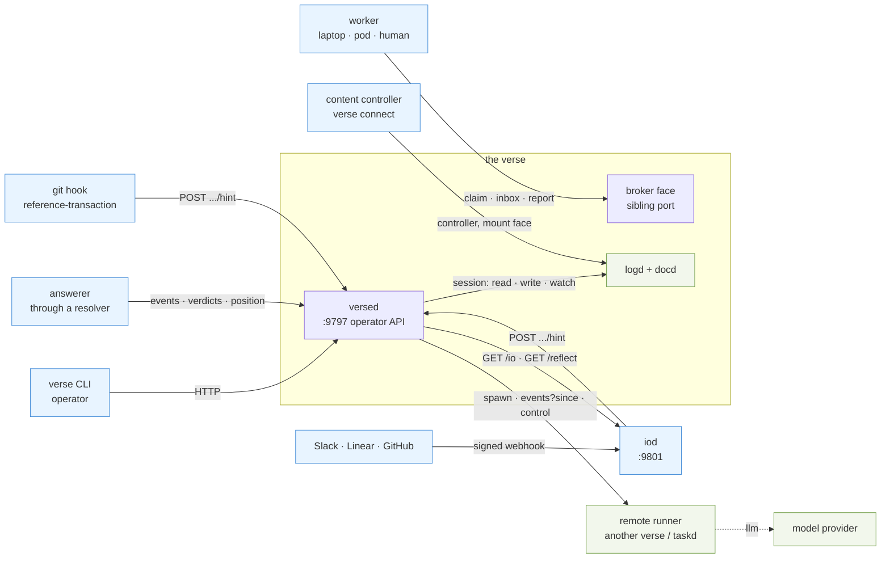
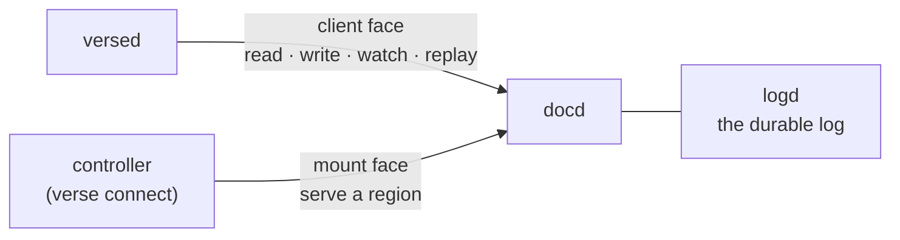
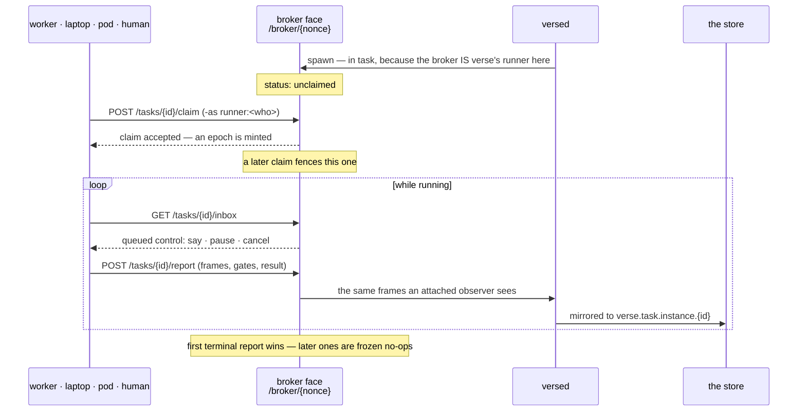
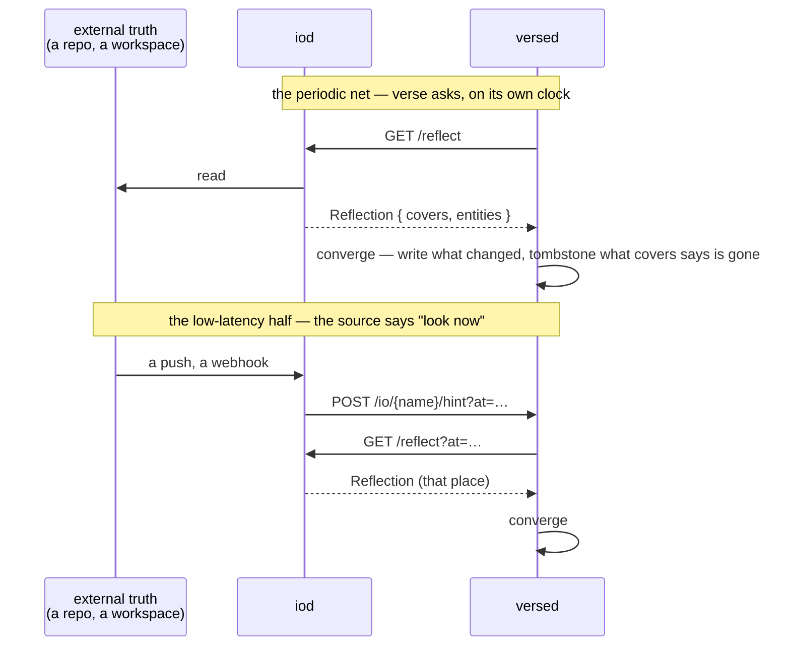

# Seams that can be a network

Every seam in verse is an interface first. This note is about the subset that can also be a *wire*,
where the two sides may sit in different processes, on different hosts, in different networks, and
about the one property that decides what each of them is good for:

**which side opens the connection.**

That is not a deployment detail. It says whether a runtime can live on a laptop, a source inside
somebody else's cloud, or an executor behind a firewall that permits no inbound traffic at all. Two
seams here carry almost the same payload in opposite directions, and the difference between them is
the whole reason both exist.

## Why the seams have the shape they do

Verse governs systems it does not own. Everything across these boundaries is one of exactly two
moves. **Observe**: a source reflects external truth in, a run reports frames back. Or **request a
change**: a spawn, a patch, a control POST. Nothing here can *hold* the state it governs. A
repository, a Slack workspace, somebody's laptop and somebody's afternoon all move without asking,
and a seam is precisely the admission that they do.

An orchestrator needs the opposite. To sequence steps it has to hold a position in a plan, and that
position is a second claim about state it does not own, wrong the moment the world moves between two
steps. So the absence of an orchestrator is not a stylistic choice about workflows. **It is what is
left once you accept that every one of these boundaries is observe-and-request.** Level-triggered
reaction to what was observed is the only model that stays true when the far side changes without
telling you.

Which is why a flow is *derived and never stored*. `verse flow show <subject>` assembles a subject's
shape per request by joining three sources, and no one of them is sufficient. The **charter** knows
the future, so a hook that has not fired yet is shown pending rather than missing. The **mirror**
holds the history, since a finished task leaves the live registry and survives only as
`verse.task.instance` entities. The **registry** has the present. Materializing that tree would be
the stored per-subject index a query stands in for.

The consequence is that the model is in the addressing rather than in a structure somebody
maintains. A task id is a function of (rule, subject). A resolver's cover is `resolver@stream`,
minted per subject and per run. Parent and child in a flow tree *are* prefix and extension of the
chain kpath, so nesting needs no parent pointer to keep correct. There is no orchestrator to remove
because there is nowhere for one to live.

For what the components *are*, read [the overview](overview.md) first. This note assumes it.

## The map



Blue dials *into* verse. Green is dialled *by* verse. `iod` is both, and that is the point
of [seam 6](#6-ios--read-one-way-hint-and-act-the-other).

The two paths into a hint are not a choice between routes. They are different systems, and which
one a source takes is decided by what its external system will let you install. Slack and Linear
will only *call* you, so `iod` has to be there to receive the delivery, verify its signature,
and turn it into a hint. Git will run a script for you, so `Git.InstallHook` writes a four-line
`reference-transaction` hook that curls the hint route itself, and `iod git` serves **no
delivery routes at all** and is not in that path. That is the shape every source would have if
every external system let you install a four-line shell script.

## The seams at a glance

| # | Seam | Who opens it | Contract | Today |
|---|------|--------------|----------|-------|
| 1 | [Operator API](#1-the-operator-api) | client → verse | ~60 HTTP routes, two planes | built |
| 2 | [Store](#2-the-store-two-faces-not-one) | verse → docd | logd session; client + mount faces | built |
| 3 | [Content](#3-content-federation-a-read-that-follows-the-reference-out) | controller → docd | `libctl` controller on the mount face | built |
| 4 | [Remote runner](#4-task-control-dialled-out) | verse → runner | `POST /tasks`, `GET /events?since`, control | built |
| 5 | [Broker](#5-task-control-dialled-in) | worker → verse | `claim` · `inbox` · `report` under a nonce | built |
| 6 | [Ios](#6-ios--read-one-way-hint-and-act-the-other) | both, by question | `GET /io`, `GET /reflect`; `POST …/hint`, `POST …/pass` | built (`dial-in` is not) |
| 7 | [Webhooks](#7-webhooks-the-only-seam-facing-the-internet) | external → source | signed `POST` | built |
| 8 | [Resolvers](#8-resolvers-answering-from-the-runs-own-stream) | answerer → verse | SSE frames; verdict; position | built |
| 9 | [Model provider](#9-the-model-provider) | task → provider | the driver's client | built |

## 1. The operator API

The `verse` CLI, a script, or `curl` dials versed. Everything an operator does crosses here,
and the surface keeps two planes apart on purpose: **observation** — `watch`, `entities`,
`gates`, `flows` — may lag, while **control** — `gate resolve`, `flow` steering,
task `cancel`/`say` — is serviced ahead of it. An intervention that queues behind a backlog
of observations is an intervention defeated ([deployment and steering](deployment-and-steering.md)).

Representation is negotiated rather than fixed: tony by default, JSON or YAML on request
([representation](reference/representation.md)). Errors are the deliberate exception — always
plain text, because a caller reads a non-2xx body as a message and a person running `curl` is
better served by a sentence than a document.

This is the **trusted** side. There is no authentication on it. The default bind is
`localhost:9797`, and in the Kubernetes deploy its Service is cluster-internal with no Ingress.

## 2. The store: two faces, not one

Verse holds one logd session to docd and does everything through it: reads, conditional writes,
per-subtree watches, and `since=<rev>` replays. That is the **client** face.

docd serves a second, separate **mount** face for controllers: the way a program declares
itself the server of some region of the document. Nothing about verse's own traffic goes there,
which is why the two are distinct addresses rather than one.



Both addresses are published on `GET /status`, and that is load-bearing rather than
decorative: `verse up` chooses ephemeral ports for the daemons it spawns, so a controller
started as its own process has no way to guess them. It asks.

## 3. Content federation: a read that follows the reference out

`verse connect` writes a working tree's *file metadata* into a scope as entities, and serves the
*bytes* from a controller it runs itself against docd's mount face. The contents are never
stored.

What makes this a seam rather than a cache is that the indirection is invisible from above. An
agent's `read_file` becomes an ordinary `Get` at `local.dir-content-<scope>.<path>`, and docd
resolves that path to the mounted controller, which stats and reads the file *at request time*,
confined to its root and capped in size, answering null for a traversal attempt or a non-regular
file. It looks like a store read the whole way down, and is a live filesystem read at the bottom.

So the tree stays where it is, under its owner's lifetime, and only the entities describing it
are what a charter reacts to. The write half — an agent changing a federated file — is
not built, because a write is an outbound effect rather than
a read run backwards, and it needs a definite target that a read does not.

## 4. Task control, dialled out

`runner.HTTP(base)` drives another verse, a `taskd`, or anything speaking the same contract:

```
POST   {base}/tasks                        spawn
GET    {base}/tasks                        list
GET    {base}/tasks/{id}                   snapshot
GET    {base}/tasks/{id}/events?since=<n>  the read plane, resumable
POST   {base}/tasks/{id}/cancel|say|resolve
PUT    {base}/tasks/{id}/vector
```

`?since=` is handed to the *remote's* own cursor, so the decision about what is still retained is
made by the side that knows. A reader that has fallen below the window is told, with a resync
marker, rather than silently handed a stream that starts mid-story.

The cost of this direction is the ordinary one: **verse must be able to reach the runner.** A
runtime on a private network, a laptop, or a cluster that permits no inbound connection cannot
be a remote runner. That constraint is what seam 5 exists to remove.

## 5. Task control, dialled in

The broker is seam 4 turned inside out. Verse hosts a worker-facing handler under
`/broker/<nonce>`, and the *worker* opens the connection:



Three things make this more than a polling loop. The **nonce is the capability**: 128 bits of
`crypto/rand`, where knowing the URL is the grant to act as that runner's worker, which is why the
broker face is meant for a *sibling* port kept distinct from the trusted operator API. The **claim
mints an epoch**, so a displaced or zombie worker is fenced rather than allowed to corrupt the log.
And the **terminal is once**: the first terminal writer wins and later reports are idempotent
no-ops.

The well-known nonce `local` is the built-in supervisor, so the in-process runtime is reached
through the same shape as everything else. There is no privileged local path.

Because the seam is uniform, a **human is a runner**. `verse task do <verb> -as <who>`
is the executor's leg of exactly this protocol, and `-as` is required because a claim must be
attributable. Every `verse task` verb works the same whether the work is local, remote, or
in somebody's terminal.

## 6. Ios — read one way, hint and act the other

This is the seam whose direction splits by *question*, and it is worth reading closely — it is
also the one the io generalises from: one program, two halves, distinguished by nothing except
which side dials.

Verse dials the source to **read**. Two routes are the whole contract: one question about what the
program is, one about what it sees.

```
GET {url}/io                  → Descriptor  { root, owns }
GET {url}/reflect[?at=<address>] → Reflection  { covers, entities }
```

The source dials verse to **hint** — `POST /io/{name}/hint` — and a hint carries
which place went stale and nothing else.



**A hint only schedules; the reconcile is the authority.** A dropped hint costs latency and never
correctness, because the periodic pass catches it, which is why a full hint queue drops rather than
blocks. That is the same level-triggered discipline the whole engine runs on, and it is what lets
this seam be unreliable without being wrong.

**The OUT half is the same seam pointed the other way, and it is the io that dials.** It reads what
is asked of it under the place it owns, makes the external system match, and writes a status per
request; it reports each pass (`POST /io/{name}/pass`), because verse cannot see a half it does not
dial. Nothing here is pushed to it and nothing is delivered exactly once — which is what makes the
two halves one discipline rather than two, and why a connector that could only be reached would
need an Ingress while one that dials needs nothing
([io.md](io.md#the-out-half-verse-asks-the-io-does-it)).

A third direction rides the same connection where the external system offers one: what people DO
over there — a reply, a mention — reaching verse as a control request made as the person who did
it, never as the io ([io.md](io.md#control-what-people-do-over-there)). Slack's Socket Mode is the
worked example: the io dials out, so clicks and replies arrive with no public url anywhere.

The direction split matters in deployment: in the Kubernetes build, verse reaches the source at
`http://<source>:9801/reflect`, and the source is configured with
`http://verse:9797/io/<name>/hint` to call back. Neither is simply the other's
client.

Two variants avoid the network entirely or do not exist yet. `-dir` reflects a local git
repository **in task** — no `iod`, no port. And `dial-in`, for a source verse must not
dial, is designed and **refused at install** until it is built ([ios](reference/io.md)).

## 7. Webhooks: the only seam facing the internet

A source may accept deliveries from the system it reflects. Three ship:

| Route | Verification |
|---|---|
| `POST /slack/events` | HMAC-SHA256 over `v0:{ts}:{body}`, constant-time, plus a skew window on the signed timestamp |
| `POST /linear/webhook` | HMAC-SHA256 over the body, constant-time |
| `POST /github/webhook` | HMAC-SHA256 over the body, `sha256=`-prefixed, constant-time |

This is the only seam meant to be reachable from the public internet. In the deploy it is the only
one that gets an Ingress, and an absent webhook host *drops* the Ingress rather than emitting one
pointed at nothing. It is also the only seam that authenticates, which is not a coincidence: it is
the only one whose caller is a stranger.

A delivery is converted to a hint and nothing more. Nothing a webhook says is trusted as truth;
it is trusted only as a reason to go and look.

## 8. Resolvers: answering from the run's own stream

An answerer is a party that answers a run's gates through a resolver. It dials verse at a
**cover**, one resolver reading one gate stream:

```
GET  /resolvers/cover/{id}/events     the frames — SSE
POST /resolvers/cover/{id}/verdicts   approve · deny · escalate
POST /resolvers/cover/{id}/position   how far it has read
```

The events route serves **the same stream an attached observer sees**, not a projection of it. That
is a design requirement rather than an implementation convenience: the moment it is a different
stream there are two orders to reconcile, and a supervised run reads differently depending on who is
looking.

An answerer that falls below the retained window is told, and only in that case is also sent the
gates still open, because the replay it missed is exactly where they were.

## 9. The model provider

The `llm` driver dials a provider from wherever the task actually runs, which is not
necessarily where the charter was installed. That is the common gotcha, so `GET /status`
publishes a secrets-safe summary of the LLM configuration of *this* server — the one hosting
the runtime — with the keys elided.

## Direction, and what it buys

Read the whole note as this table.

| If it must live… | Use | Because |
|---|---|---|
| beside verse | local runner (`/broker/local`) | no wire at all |
| anywhere verse can reach | remote runner (4) | verse opens the connection |
| behind a firewall, on a laptop, in a person's hands | broker (5) | the worker opens it, and holds a nonce |
| in a system verse may dial | source `url` (6) | verse asks; hints are an optimization |
| in a system verse may **not** dial | source `dial-in` | **designed, not built** |
| in somebody else's org, pushing in | webhook (7) | signed, and only ever a hint |

## What is not a seam

Worth naming, so the map is not read as bigger than it is. The **driver** — `scripted`, `calls`,
`llm`, your own `Next` — is a Go interface and never a wire. A `-dir` **source** runs in task. The
**local runner** is a Go call. The `Store` interface admits a memory implementation with no daemon
behind it, which is what the tests run on.

Each of those can *become* a wire without the callers changing, which is what makes it a seam in the
first place, but none of them is one.
