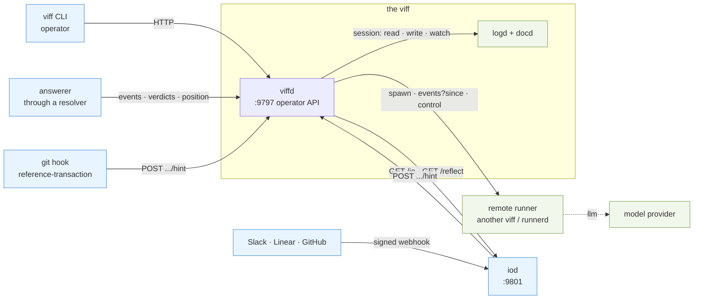
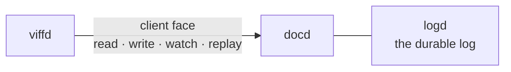
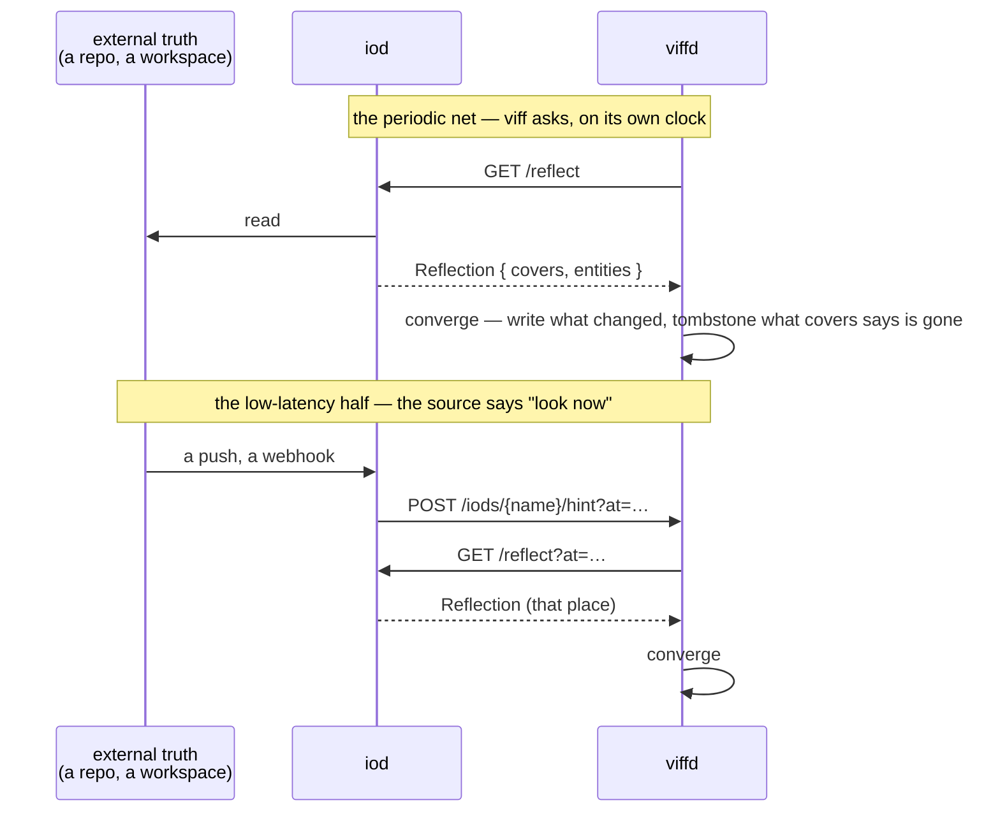

| 2 | [Store](#2-the-store) | viff → docd | logd session, on the client face | built |
# Seams that can be a network

A [seam](glossary.md#seam) is an interface between two parts of viff. Every seam is a Go
interface first. This page is about the seams that can also be a *wire*: the two sides may run
in different processes, on different hosts, or in different networks.

One property decides what each of these seams is good for:

**which side opens the connection.**

The direction decides where a part can run:

- a runtime on a laptop;
- an [iod](glossary.md#iod) inside the cloud of another organization;
- an [executor](glossary.md#executor) behind a firewall that accepts no inbound connection.

Two of the seams carry almost the same payload in opposite directions. The direction is the
difference between them, and it is the reason that both exist.

Read [the overview](README.md) first. It says what the components are, and this page assumes
it. [Why the seams have the shape they do](#why-the-seams-have-the-shape-they-do), at the end,
gives the reasons for the design.

## The map



A blue box dials *into* viff. Viff dials a green box. `iod` is both, and
[seam 6](#6-iods-read-one-way-hint-and-act-the-other) is about that.

A [hint](glossary.md#hint) reaches viff by one of two paths. The two paths are not two routes
to choose from. They belong to different systems. What the external system lets you install
decides which path an iod takes.

| External system | What it allows | The path of a hint |
|---|---|---|
| Slack, Linear | it only *calls* you | `iod` receives the delivery, verifies its signature, and turns it into a hint |
| Git | it runs a script for you | `Git.InstallHook` writes a four-line `reference-transaction` hook, and the hook curls the hint route itself |

`iod git` serves **no delivery routes at all**, and it is not in the path of a hint. Every iod
would have this shape if every external system let you install a four-line shell script.

## The seams at a glance

| # | Seam | Who opens it | Contract | Today |
|---|------|--------------|----------|-------|
| 1 | [Operator API](#1-the-operator-api) | client → viff | ~60 HTTP routes, two planes | built |
| 2 | [Store](#2-the-store) | viff → docd | logd session, on the client face | built |
| 4 | [Remote runner](#4-task-control-dialled-out) | viff → runner | `POST /tasks`, `GET /events?since`, control | built |
| 6 | [Iods](#6-iods-read-one-way-hint-and-act-the-other) | both, by question | `GET /io`, `GET /reflect`; `POST …/hint`, `POST …/pass` | built (`dial-in` is not) |
| 7 | [Webhooks](#7-webhooks-the-only-seam-facing-the-internet) | external → source | signed `POST` | built |
| 8 | [Resolvers](#8-resolvers-answering-for-whoever-grants-it) | answerer → viff | SSE frames; verdict; position | built |
| 9 | [Model provider](#9-the-model-provider) | task → provider | the agent's client | built |

## 1. The operator API

The `viff` CLI, a script or `curl` dials viffd. Everything an operator does goes through this
seam. The API keeps two planes apart.

| Plane | Routes | How viff serves it |
|---|---|---|
| **observation** | `watch`, `entities`, `gates`, `flows` | it may be late |
| **control** | `gate resolve`, `flow` steering, task `cancel`/`say` | viff serves it before observation |

An intervention that waits behind many observations does not help
([deployment and steering](deployment-and-steering.md)).

The client chooses the representation. The default is tony, and a client may ask for JSON or
YAML ([representation](reference/representation.md)). Errors are the one exception: an error
is always plain text.

A caller reads the body of a non-2xx answer as a message. A person who runs `curl` reads a
sentence more easily than a document.

This side is **trusted**. It has no authentication. The default bind is `localhost:9797`. In the
Kubernetes deploy, its Service is internal to the cluster and has no Ingress.

## 2. The store

Viff holds one logd session to docd, and does everything through it:

- reads;
- conditional writes;
- watches of one subtree;
- replays with `since=<rev>`.

This is the **client** face of docd. docd serves a second face, on which a program may declare
that it serves one region of the document; none of viff's traffic goes there, and viff mounts
nothing. Every place a rule watches has the log behind it
([change events](change-events.md#a-history-bearing-watch-and-a-composed-one)).



`GET /status` publishes the client address, so a store client that runs as its own process
beside viff finds docd without guessing the ephemeral port `viff up` chose.

## 4. Task control, dialled out

`client.HTTP(base)` drives another viff, a `runnerd`, or any program that serves the same
contract:

```
POST   {base}/tasks                        spawn
GET    {base}/tasks                        list
GET    {base}/tasks/{id}                   snapshot
GET    {base}/tasks/{id}/events?since=<n>  the read plane, resumable
POST   {base}/tasks/{id}/cancel|say|resolve
PUT    {base}/tasks/{id}/autonomy
```

Viff hands `?since=` to the cursor of the *remote*. The remote knows what it still keeps, so
the remote decides. A reader whose cursor is below the kept window gets a resync marker. It does
not get a stream that starts in the middle without notice.

This direction has a cost: **viff must be able to reach the runner.** A runtime on a
private network, on a laptop, or in a cluster that accepts no inbound connection cannot be a
remote runner.

## 6. Iods: read one way, hint and act the other

In this seam, the direction depends on the *question*. The iod is built on this seam: one
program with two halves, and the only difference between the halves is which side dials.

Viff dials the [source](glossary.md#source) to **read**. Two routes are the whole contract.
One asks what the program is, and one asks what the program sees.

```
GET {url}/io                  → Descriptor  { root, owns }
GET {url}/reflect[?at=<address>] → Reflection  { covers, entities }
```

The source dials viff to **hint**, with `POST /iods/{name}/hint`. A hint says which address went
stale, and nothing else.



**A hint only schedules. The reconcile is the authority.** A hint that is lost makes viff
slower, and never makes it wrong: the periodic pass reads the change anyway. For this reason a
full hint queue drops a hint rather than blocks. The whole engine is level-triggered in the same
way, so this seam may be unreliable and still correct.

**The out half is the same seam in the other direction, and the iod dials.** The
[sink](glossary.md#sink) does these things:

1. It reads what is asked of it under the address it owns.
2. It makes the external system match.
3. It writes a status for each request.
4. It reports each pass with `POST /iods/{name}/pass`, because viff cannot see a half that viff
   does not dial.

Nothing is pushed to the sink, and nothing is delivered exactly once. For this reason the two
halves follow one discipline. An iod that viff had to reach would need an Ingress. An iod that
dials needs nothing ([io.md](io.md#the-out-half-viff-asks-the-iod-does-it)).

Some external systems offer a connection of their own, and an iod can use it for a third
direction. What people do in the external system, such as a reply or a mention, reaches viff
as a control request. Viff makes the request as the person who acted, and never as the iod
([io.md](io.md#control-what-people-do-over-there)). Slack's Socket Mode is the worked example.
The iod dials out, so clicks and replies arrive with no public URL anywhere.

The direction matters in a deployment. In the Kubernetes build:

- viff reaches the source at `http://<source>:9801/reflect`;
- the source calls back at `http://viff:9797/iods/<name>/hint`.

Neither side is only the client of the other.

Two variants use no network, or do not exist yet.

| Variant | What it is |
|---|---|
| `-dir` | reflects a local git repository **in task**, with no `iod` and no port |
| `dial-in` | for a source that viff must not dial. It is designed, and viff **refuses it at install** until it is built ([iods](reference/io.md)). |

## 7. Webhooks: the only seam facing the internet

A source may accept deliveries from the system it reflects. Three ship:

| Route | Verification |
|---|---|
| `POST /slack/events` | HMAC-SHA256 over `v0:{ts}:{body}`, constant-time, plus a skew window on the signed timestamp |
| `POST /linear/webhook` | HMAC-SHA256 over the body, constant-time |
| `POST /github/webhook` | HMAC-SHA256 over the body, `sha256=`-prefixed, constant-time |

This is the only seam that is meant to be reachable from the public internet. In the deploy, it
is the only seam that gets an Ingress. When no webhook host is set, the deploy *drops* the
Ingress, and does not make one that points at nothing.

It is also the only seam that authenticates. The reason is that it is the only seam whose
caller is a stranger.

The source turns a delivery into a hint and nothing more. Viff does not trust what a webhook
says as truth. It trusts a webhook only as a reason to go and look.

## 8. Resolvers: answering for whoever grants it

A [resolver](glossary.md#resolver) is a service that answers asks for the people and places that
grant it. Its service is whoever installed it, acting as it (`Viff-Resolver`), and it uses the
routes anybody does:

```
GET  /watch?at=mirror.ask          the asks it may read — its subscription
GET  /resolvers/{name}/asks       the waiting asks it serves, and for whom
POST /asks/{id}/answer {…, for}   an answer, which is its party's
POST /asks {…, serves}            an onward ask, carried back when it settles
```

For context it reads the run and the subject through the ordinary routes, and sees what its
installer sees. [Resolvers](attached-resolvers.md) has the model.

## 9. The model provider

The viff agent, `agent: {name: viff}`, dials a model provider from the place where the task
runs. That place is not always where the charter was installed, and this often surprises
people. For this reason `GET /status` publishes a summary of the LLM configuration of *this*
server, which is the server that hosts the runtime. The summary is safe to show: it leaves out
the keys.

## Direction, and what it buys

This table is the summary of the page.

| If it must live… | Use | Because |
|---|---|---|
| beside viff | the local runner (`viff up` starts it) | a runner like any other, on loopback |
| anywhere viff can reach | remote runner (4) | viff opens the connection |
| in a system viff may dial | source `url` (6) | viff asks; hints are an optimization |
| in a system viff may **not** dial | source `dial-in` | **designed, not built** |
| in somebody else's org, pushing in | webhook (7) | signed, and only ever a hint |

## What is not a seam

These parts are not wires. They are named here so that the map does not look bigger than it is.

| Part | What it is |
|---|---|
| the **driver** behind a task: the agent's loop, a script, or your own `Next` | a Go interface, and never a wire |
| a `-dir` **source** | runs in task |
| the **local runner** | a Go call |
| the `Store` interface | admits an implementation in memory, with no daemon behind it. The tests run on it. |

Each of these parts can *become* a wire, and its callers do not change. That makes each one a
seam, but none of them is a wire.

## Why it is this way

### Why the seams have the shape they do

Viff governs systems that it does not own. Everything across these boundaries is one of two
moves:

| Move | Examples |
|---|---|
| **Observe** | a source reflects external truth in; a run reports frames back |
| **Request a change** | a spawn, a patch, a control POST |

Nothing here can *hold* the state it governs. A repository, a Slack workspace, the laptop of a
person and the time of a person all change without asking. A seam states that they do.

An orchestrator needs the opposite. To sequence steps, it must hold a position in a plan. That
position is a second claim about state that the orchestrator does not own. It is wrong as soon
as the world changes between two steps.

For this reason viff has no orchestrator, and the reason is not a question of style.
**Accept that every one of these boundaries is observe-and-request, and no orchestrator is
left.** A level-triggered reaction to what viff observed is the only model that stays true
when the far side changes without notice.

For the same reason, viff derives a [flow](glossary.md#flow) and never stores it.
`viff flow show <subject>` builds the shape of a subject for each request. It joins three
sources, and no one of them is enough:

| Source | What it knows |
|---|---|
| the **charter** | the future. A hook that has not fired yet shows as pending, and not as missing. |
| the **mirror** | the history. A finished task leaves the live registry, and only its `mirror.task.instance` entities remain. |
| the **registry** | the present |

A stored tree would be an index for each subject, and a query does the same work.

The model is in the addresses, and not in a structure that somebody maintains:

- A task id is a function of (rule, subject).
- A parent and a child in a flow tree *are* a prefix and an extension of the chain kpath. Nesting
  needs no parent pointer to keep correct.

There is no orchestrator to remove, because there is no place for one to live.
