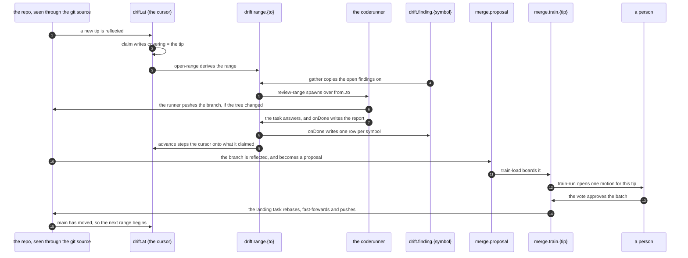
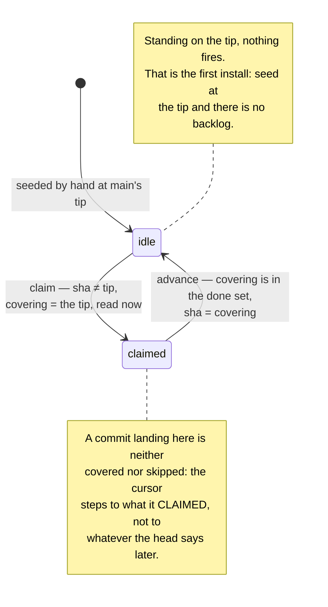
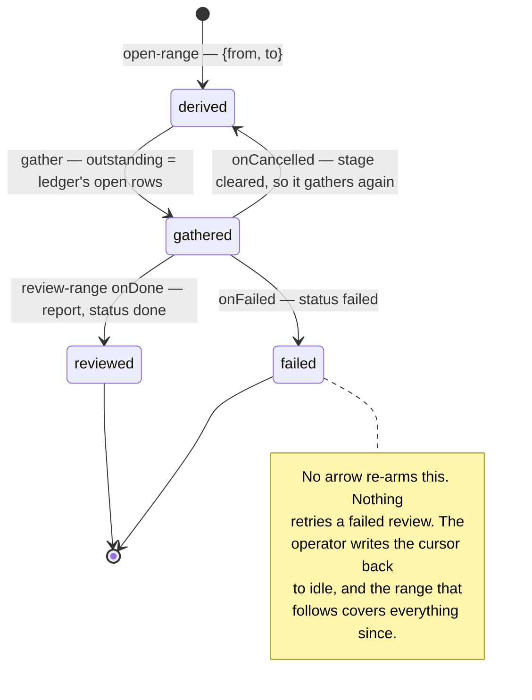
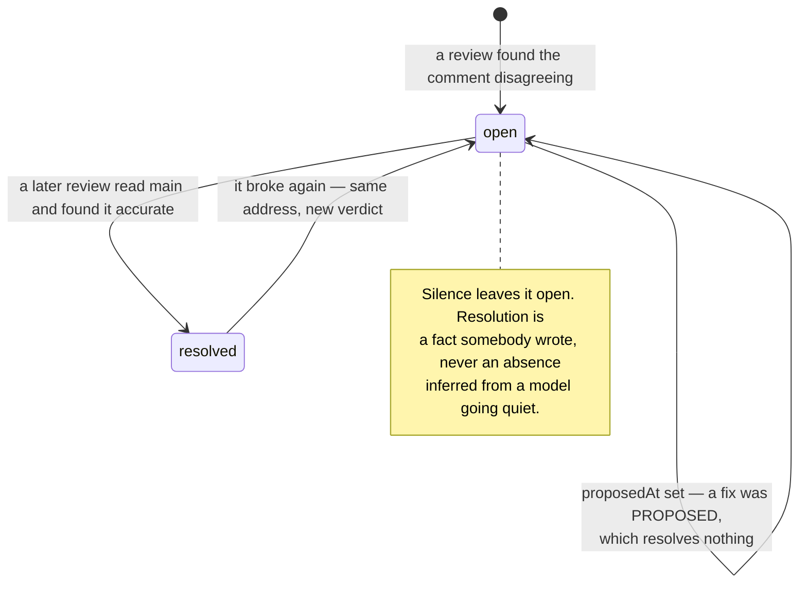
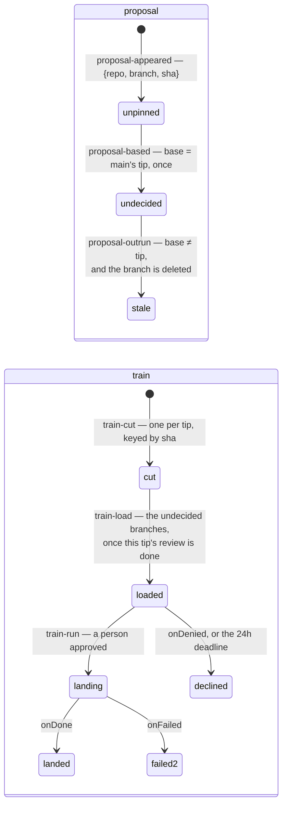

# The drive as state: what moves, and what moves it

Status: description. This is [comment-drift.tony](comment-drift.tony) read as state machines —
nothing here decides anything, and where the two disagree the charter is right.

Four entities carry the whole flow, and each field that changes is written by exactly one rule.
That is the property worth holding on to while reading: **a state is a fact somebody wrote**, so
every arrow below names the rule that draws it, and an arrow nobody draws is a state nothing can
leave.

## The loop, end to end

One push, one review, one branch, one question, one landing — and a second review that closes
what the first one opened.

**Arrow by arrow**, because the picture is only a reminder of what the rules do:

1. The git source polls the repo and writes `git:head:verse`. `claim` reads that address in its
   CONDITION, so the read is in the trigger's read set and the write is what re-evaluates it.
2. `claim` patches the cursor: `stage: claimed`, and `covering` = the tip **read at this moment**.
   That single read is the race: everything downstream is about the commit named here, not about
   whatever the head says later.
3. `open-range` derives `verse-dev.drift.range.<covering>` carrying `{from: the cursor's sha, to:
   covering}`. The range exists so the review has a subject of its own, and therefore a task id of
   its own.
4. `gather` patches `outstanding` onto the range — the ledger rows whose `status` is `open` — and
   writes `stage: gathered`, which is the latch that lets the next rule fire.
5. `review-range` spawns the llm task on the coderunner with the range's two ends in the prompt.
6. The runner delivers `verse/auto/<sha>/<task>` at the END of the task, and only if the working
   tree changed. A review that found nothing leaves no branch, which is a result rather than a
   failure.
7. The task's answer comes back and `onDone` patches the range: `report`, `status: done`,
   `stage: reviewed`.
8. The same hook derives the ledger rows through `!each` with `id: $item.symbol`, so a verdict
   lands **on** the row it is about rather than beside it.
9. `advance` steps the cursor to `covering` and back to `idle` — but only once that range is in
   the done set, so a failed review stops the line here.
10. The source reflects the delivered branch on a later poll. `proposal-appeared` derives the
    proposal from the ref, `proposal-based` pins `base` to main's tip once, and `proposal-says`
    copies the review's report onto it so the docket can ask a real question.
11. `train-load` boards the undecided branches onto the train for the current tip — the train
    itself having been derived by `train-cut` back at arrow 1, when the tip moved.
12. `train-run` opens the gate: one motion per tip, `!until [!quorum 1, !deadline "24h"]`.
13. `verse vote <id> approve --as <who>` answers it. A deny, or the deadline, writes `decided`
    instead and the batch is closed without landing.
14. The landing task rebases each car onto the tip and fast-forwards it in, then pushes main. The
    rebase is what makes a batch of siblings land as a batch rather than as its first car.
15. Main moving is a new tip, which is arrow 1 again — and the review that follows reads main,
    finds the comment accurate, and reports the finding `resolved`, overwriting the row from
    arrow 8.

**Arrows 6 and 7 are in that order for a reason, and it is the opposite of what it looks like.**
The branch is pushed BEFORE the report is written, so the proposal could in principle be derived
before the range says `done` — and then `train-load`, whose `says` read is in the action where it
opens no watch, would sit with nothing and nobody would be asked. What saves it is not the order
here but the binding in `train-load`'s condition: it asks whether this tip is among the shas that
have been REVIEWED, which puts the report in its read set. The source's poll interval usually
puts arrow 10 after arrow 7 anyway, which is exactly the kind of accident that hides a defect
until the day it does not.

## The cursor: where the review has got to

One entity, `verse-dev.drift.at`, and it bounces. A patch is what moves it, because a derive's
address is a function of (rule, subject) and its content may not carry state — a single slot
everybody overwrites is precisely what that rule forbids.

`advance` asks whether `covering` is among the shas of ranges that are `done`, so a failed review
is not in that set and the cursor stops where it broke. `verse data verse-dev.drift.at --put
'{stage: idle}'` is the retry, and by then the range covers everything since.

## The range: one review, with a subject of its own

`verse-dev.drift.range.<to>`, derived by `open-range`. It exists so the review has an entity to
be about — a task's id is (rule, subject), and with the cursor as the subject every review would
share one id.

`stage` is the latch and it sequences the two rules: a spawn's strings bind against the payload
that FIRED the action, so gathering and spawning in one action would hand the task the payload
from before its own write.

## The finding: a claim about main, keyed by symbol

`verse-dev.drift.finding.<symbol>`, written by the review's `onDone` through `!each` with `id:`.
The address is the symbol alone, so a later verdict lands **on** the row rather than beside it.

A fix lives on a branch until somebody approves it, and branches are declined, superseded and
retired — so `proposedAt` records where the attempt was made while `status` stays `open`. A
finding still open with a `proposedAt` behind it is a fix that did not land, visible in the
ledger rather than lost with the branch.

## The proposal and the train: what a person answers

A delivered branch becomes `verse-dev.merge.proposal.*`; the batch is `verse-dev.merge.train.<tip>`,
one per tip so a new main is a new question.

Two edges are worth stating in words:

**`train-load` waits for the review.** Its condition asks whether this tip is among the shas that
have been reviewed, and that read is what wakes it when the report lands. The `says` read that
carries the report onto the train is in the ACTION, which opens no watch — so without the
condition's read the train would sit loaded with nothing and nobody would be asked.

**`proposal-outrun` is the staleness test, and it is just a comparison.** `base ≠ tip`, read from
the same snapshot the condition is evaluated against. No ancestry walk, no remote asked anything,
no model.

## Where this is not the whole truth

- The landing task iterates the `verse/auto/*` refs it finds in the clone rather than the
  branches the train listed, so the set a person approves and the set that lands are not the same
  set (`a6c8pxh7h12ksbhtgsn0`). The diagram draws the intent; the issue holds the gap.
- `stage: failed` on a range has no arrow out of it, and that is honest rather than an omission:
  nothing re-arms a failed review, and the operator's write is what starts it again.
