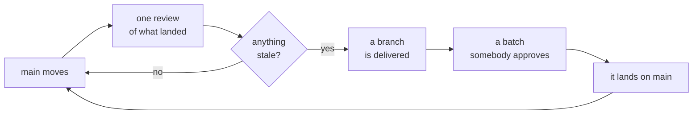
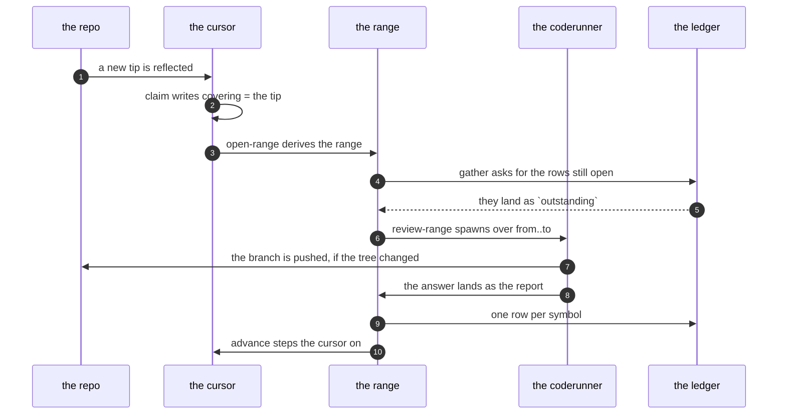
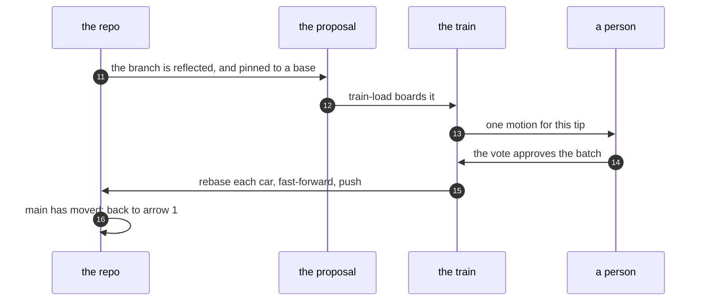
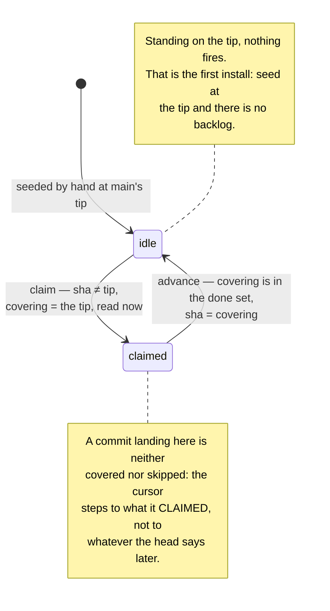
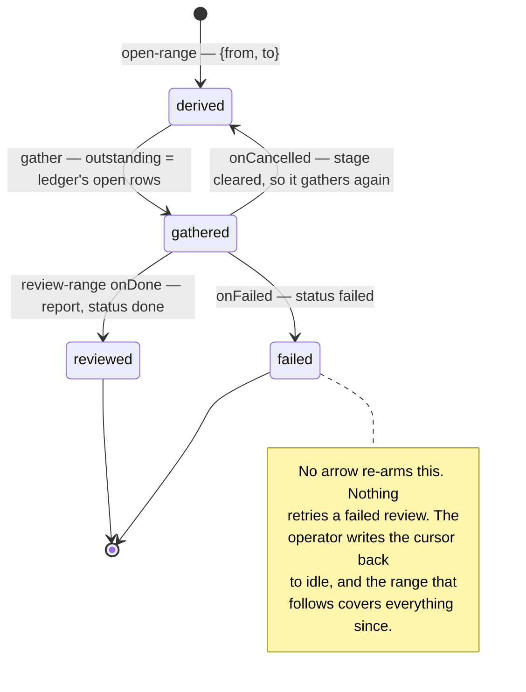
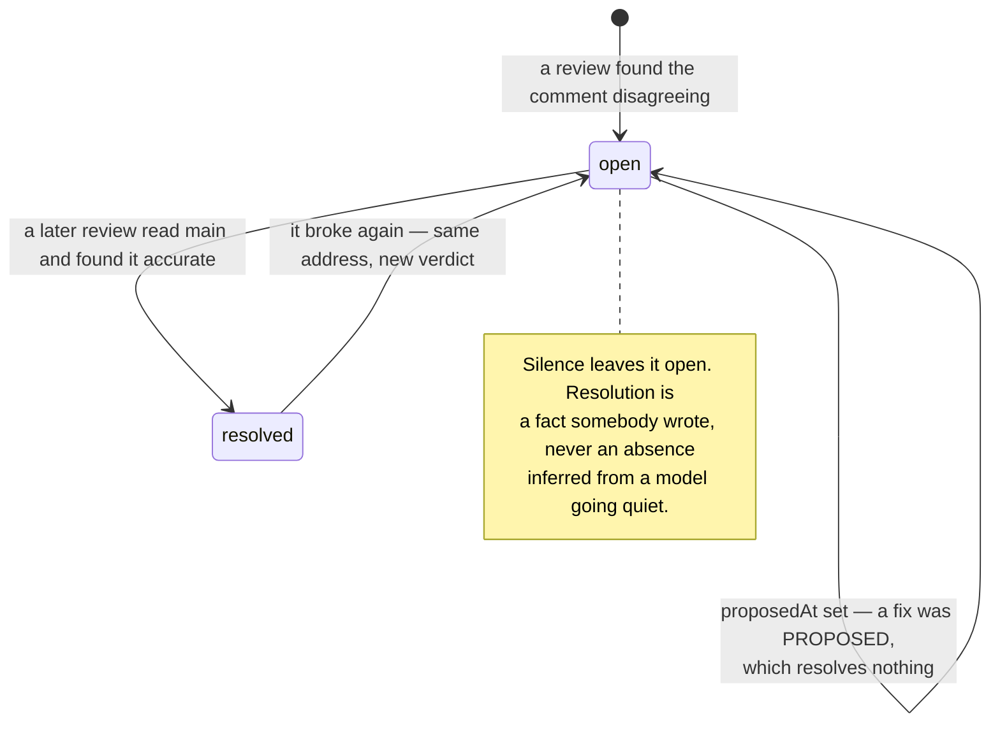
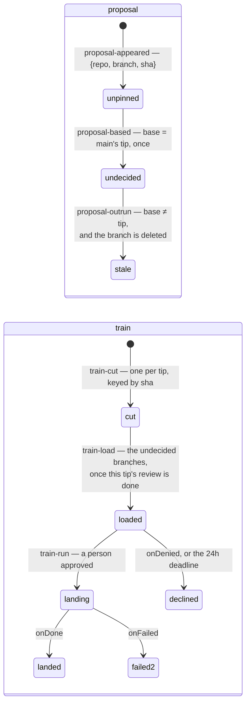

# The drive as state: what moves, and what moves it

Status: description. This is [comment-drift.tony](comment-drift.tony) read as state machines —
nothing here decides anything, and where the two disagree the charter is right.

Five entities carry the whole flow, and each field that changes is written by exactly one rule:

| entity | what it holds |
|---|---|
| `verse-dev.drift.at` | the cursor — where the review has got to, and what it has claimed |
| `verse-dev.drift.range.<to>` | one review, of `from..to`: its standing set, its report, its state. Addressed by its FAR end — see below |
| `verse-dev.drift.finding.<symbol>` | the ledger — one row per symbol, open or resolved |
| `verse-dev.merge.proposal.*` | a delivered branch, the base it was cut from, and what became of it |
| `verse-dev.merge.train.<tip>` | the batch somebody is asked about, one per tip of main |

The first three belong to the review half and the last two to the merge gate, which are separate
packages: the review may not read `merge:*` at all, and that is what keeps the graph between them
a chain rather than a loop.

That is the property worth holding on to while reading: **a state is a fact somebody wrote**, so
every arrow below names the rule that draws it, and an arrow nobody draws is a state nothing can
leave.

## The shape, in five moves

Before the detail: the whole drive is a cycle, and the only step a person is in is the fourth.



The two halves below are that cycle at working size: the REVIEW is `main moves → a branch`, and
the MERGE GATE is `a branch → it lands`. They meet at the branch and nowhere else, which is why
they are two packages rather than one.

## The review half: main moves, and something is written down



1. The git source polls and writes `git:head:verse`. `claim` reads that address in its CONDITION,
   so the write re-evaluates it — no `on:` clause anywhere.
2. `claim` patches the cursor: `stage: claimed`, and `covering` = the tip **read at this moment**.
   That single read is the race: everything downstream is about the commit named here.
3. `open-range` derives `drift.range.<covering>` with `{from: the cursor's sha, to: covering}` —
   a subject of its own, and therefore a task id of its own.
4. The range APPEARING is what fires `gather`, whose subject is the range and whose condition is
   `!not.has-path stage`. Nothing prompts the ledger — it is read, not asked: the rule's own
   action carries `!list-paths` over the rows whose `status` is `open`.
5. Those rows land on the range as `outstanding`, beside `stage: gathered` — the latch that lets
   the next rule fire, and the reason gathering and spawning are two rules rather than one: a
   spawn's strings bind against the payload that FIRED it, so one action doing both would hand
   the task the payload from before its own write.
6. `review-range` spawns the llm task on the coderunner, the range's two ends in its prompt.
7. The runner delivers `verse/auto/<sha>/<task>` at the END of the task, and only if the working
   tree changed. A review that found nothing leaves no branch.
8. The answer comes back: `onDone` writes `report`, `status: done`, `stage: reviewed`.
9. The same hook writes the ledger through `!each` with `id: $item.symbol`, so a verdict lands ON
   the row it is about rather than beside it. This is the one arrow into the ledger.
10. `advance` steps the cursor onto `covering` and back to `idle` — but only once that range is in
    the done set, so a failed review stops the line here.

## The merge half: a branch becomes a question



11. On a later poll the source reflects the branch. `proposal-appeared` derives the proposal,
    `proposal-based` pins `base` to main's tip once, and `proposal-says` copies the review's
    report onto it so the docket can ask a real question.
12. `train-load` boards the undecided branches onto the train for the current tip — the train
    having been derived by `train-cut` back at arrow 1, when the tip moved.
13. `train-run` opens the gate: one motion per tip, `!until [!quorum 1, !deadline "24h"]`.
14. `verse vote <id> approve --as <who>` answers it. A deny, or the deadline, writes `decided`
    without landing anything.
15. The landing task rebases each car onto the tip and fast-forwards it in, then pushes main. The
    rebase is what makes a batch of siblings land as a batch rather than as its first car.
16. Main moving is a new tip, which is arrow 1 again — and the review that follows reads main,
    finds the comment accurate, and reports the finding `resolved`, overwriting the row from
    arrow 9.

**Arrows 7 and 11 are in that order for a reason, and it is the opposite of what it looks like.**
The branch is pushed BEFORE the report is written, so the proposal can be derived before the
range says `done` — and then `train-load`, whose `says` read is in the action where it opens no
watch, would sit with nothing and nobody would be asked. What saves it is the binding in
`train-load`'s condition: it asks whether this tip is among the shas that have been REVIEWED,
which puts the report in its read set. The source's poll interval usually puts arrow 11 after
arrow 8 anyway, which is exactly the kind of accident that hides a defect until the day it does
not.

## The cursor: where the review has got to

One entity, `verse-dev.drift.at`, and it bounces. A patch is what moves it, because a derive's
address is a function of (rule, subject) and its content may not carry state — a single slot
everybody overwrites is precisely what that rule forbids.



Standing still, it is two fields — and the absence of `covering` is what says nothing is in
flight:

```tony
verse data verse-dev drift at

sha: 07c4d164220836aec5c04afd0cb53a39067f90e4
stage: idle
```

`advance` asks whether `covering` is among the shas of ranges that are `done`, so a failed review
is not in that set and the cursor stops where it broke. `verse data verse-dev.drift.at --put
'{stage: idle}'` is the retry, and by then the range covers everything since.

## The range: one review, with a subject of its own

`verse-dev.drift.range.<to>`, derived by `open-range`. It exists so the review has an entity to
be about — a task's id is (rule, subject), and with the cursor as the subject every review would
share one id.

**Why `to` and not `from`, and not both.** The chain is serial: each range begins where the last
one ended, so the far end determines the near one and an id carrying both would be a separator
convention somebody has to parse. The deciding reason is who asks. Everything downstream wants
"what did the review of the commit main is standing on say" — `train-load` reads
`drift.range.<tip>.report`, and that tip is a range's far end. Keyed by `from`, no reader could
name that review without searching for it by content. `from` is in the payload, where a reader
who wants the span can have it.



A range that has been through, on a push carrying no Go at all — `files: 0` is a real answer:

```tony
verse data verse-dev drift range

07c4d164220836aec5c04afd0cb53a39067f90e4:
  from: 643602e878685ad1fc4c2c2c799b2b13cd36dd8f
  outstanding: []
  report:
    files: 0
    findings: []
  stage: reviewed
  status: done
  to: 07c4d164220836aec5c04afd0cb53a39067f90e4
  verse:
    meta:
      derivedFrom:
        rule: open-range
        subject: verse-dev:drift:at
```

`verse.meta.derivedFrom` is the engine's, on every derived entity: it names the rule that wrote
the address and the subject it was about, which is how a reader gets from an entity back to the
charter without guessing.

`stage` is the latch and it sequences the two rules: a spawn's strings bind against the payload
that FIRED the action, so gathering and spawning in one action would hand the task the payload
from before its own write.

## The finding: a claim about main, keyed by symbol

`verse-dev.drift.finding.<symbol>`, written by the review's `onDone` through `!each` with `id:`.
The address is the symbol alone, so a later verdict lands **on** the row rather than beside it.



One row, after the fix landed and the review that followed confirmed it — `at` is where it was
confirmed, `proposedAt` where the fix was proposed:

```tony
verse data 'verse-dev.drift.finding."entity.JoinSegs"'

at: 643602e878685ad1fc4c2c2c799b2b13cd36dd8f
proposedAt: fc3175a731930673cbc03065f2359e92614133a5
says: "the comment claims JoinSegs joins segments with a `/` and drops any that are empty, but the code joins with `.` and does not skip empty segments"
status: resolved
symbol: entity.JoinSegs
verse:
  meta:
    derivedFrom:
      rule: review-range.onDone
      subject: verse-dev.drift.range.643602e878685ad1fc4c2c2c799b2b13cd36dd8f
```

The address is quoted because the id is: `entity.JoinSegs` carries a dot, and a kinded path
quotes a segment whose content would otherwise split it.

A fix lives on a branch until somebody approves it, and branches are declined, superseded and
retired — so `proposedAt` records where the attempt was made while `status` stays `open`. A
finding still open with a `proposedAt` behind it is a fix that did not land, visible in the
ledger rather than lost with the branch.

## The proposal and the train: what a person answers

A delivered branch becomes `verse-dev.merge.proposal.*`; the batch is `verse-dev.merge.train.<tip>`,
one per tip so a new main is a new question.



The pair, from the batch that landed the plant's fix. The proposal carries the review's report
as `says` so the docket can ask a real question, and is `stale` now because main moved past the
base it was cut from:

```tony
proposal-appeared@git:ref:verse_verse_auto_fc3175a7_review-range_…-962ad9e6+8b0cc03e:
  base: fc3175a731930673cbc03065f2359e92614133a5
  branch: verse/auto/fc3175a7/review-range_…-962ad9e6
  repo: verse
  says: {files: 1, findings: [{symbol: entity.JoinSegs, status: open, …}]}
  sha: 610e3325e67393617fdb9596664f773e317a9634
  state: stale

fc3175a731930673cbc03065f2359e92614133a5:            # the train for that tip
  branches:
  - verse/auto/fc3175a7/review-range_…-962ad9e6
  decided: landed
  says: {files: 1, findings: [{symbol: entity.JoinSegs, status: open, …}]}
  sha: fc3175a731930673cbc03065f2359e92614133a5
```

`sha` means different things in the two: on a proposal it is the BRANCH's tip — the commit that
would land — and on a train it is MAIN's tip, the commit the batch is cut against. `base` is the
proposal's answer to "could this still fast-forward", pinned once and never tracked afterwards.

Two edges are worth stating in words:

**`train-load` waits for the review.** Its condition asks whether this tip is among the shas that
have been reviewed, and that read is what wakes it when the report lands. The `says` read that
carries the report onto the train is in the ACTION, which opens no watch — so without the
condition's read the train would sit loaded with nothing and nobody would be asked.

**`proposal-outrun` is the staleness test, and it is just a comparison.** `base ≠ tip`, read from
the same snapshot the condition is evaluated against. No ancestry walk, no remote asked anything,
no model.

## Where this is not the whole truth

- The landing task iterates the `verse/auto/*` refs it finds in the clone rather than the
  branches the train listed, so the set a person approves and the set that lands are not the same
  set (`a6c8pxh7h12ksbhtgsn0`). The diagram draws the intent; the issue holds the gap.
- `stage: failed` on a range has no arrow out of it, and that is honest rather than an omission:
  nothing re-arms a failed review, and the operator's write is what starts it again.
