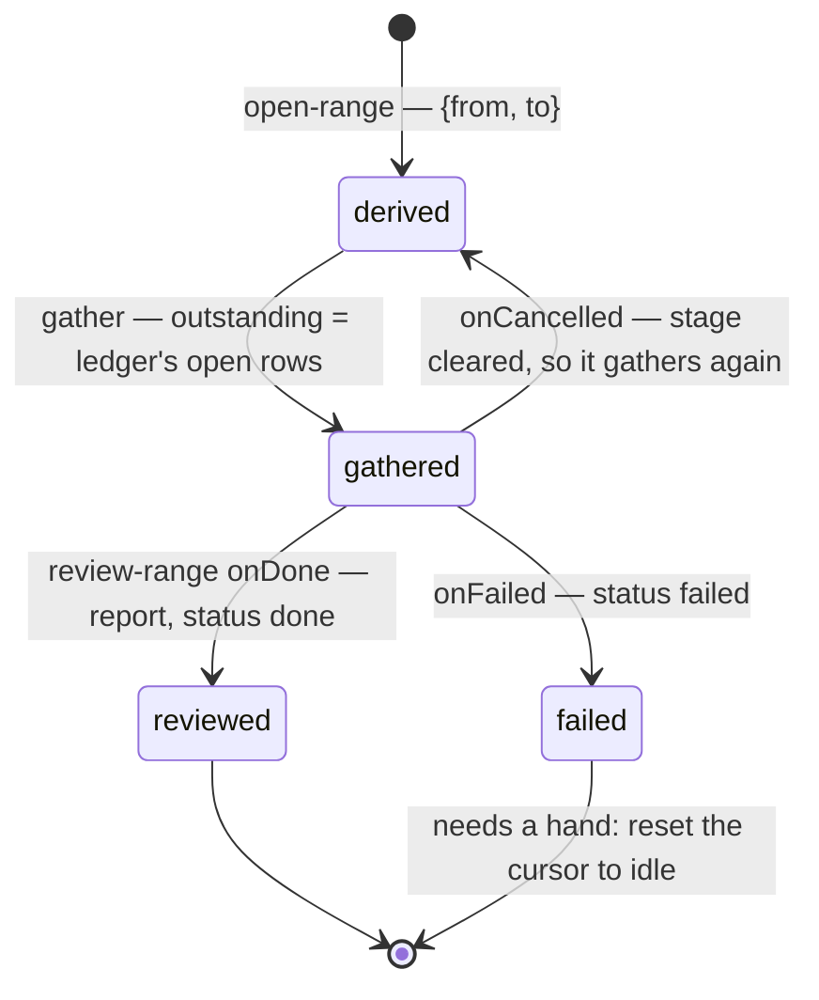
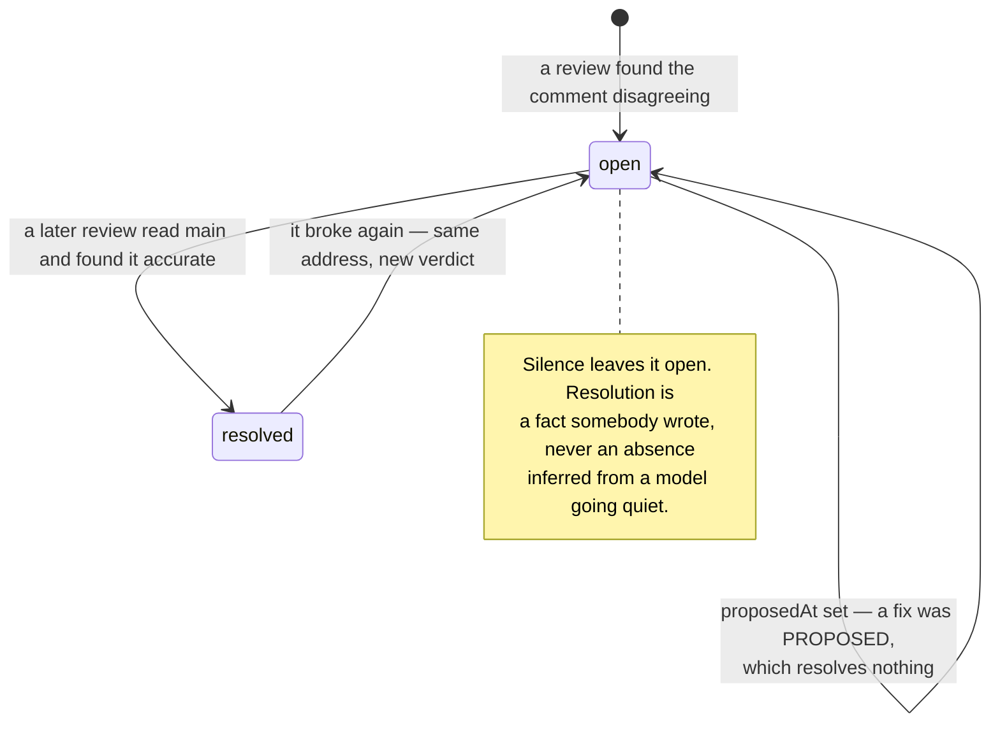

# The drive as state: what moves, and what moves it

Status: description. This is [comment-drift.tony](comment-drift.tony) read as state machines —
nothing here decides anything, and where the two disagree the charter is right.

Four entities carry the whole flow, and each field that changes is written by exactly one rule.
That is the property worth holding on to while reading: **a state is a fact somebody wrote**, so
every arrow below names the rule that draws it, and an arrow nobody draws is a state nothing can
leave.

## The loop, end to end

One push, one review, one branch, one question, one landing — and a second review that closes
what the first one opened.

```mermaid
sequenceDiagram
    autonumber
    participant git as git source
    participant cur as drift.at (cursor)
    participant rng as drift.range.&lt;to&gt;
    participant run as coderunner
    participant led as drift.finding.&lt;symbol&gt;
    participant tr as merge.train.&lt;tip&gt;
    participant who as a person

    git->>cur: tip moves — the read wakes `claim`
    cur->>cur: claim: covering = tip (read HERE, once)
    cur->>rng: open-range: {from, to}
    led->>rng: gather: outstanding = the open findings
    rng->>run: review-range: spawn over from..to
    run-->>rng: {"files": n, "findings": [...]}
    run-->>git: delivers verse/auto/&lt;sha&gt;/&lt;task&gt; (only if it changed something)
    rng->>led: onDone: one row per symbol, by id
    rng->>cur: advance: cursor steps to what it CLAIMED
    git->>tr: proposal-appeared + train-load: the branch boards
    tr->>who: train-run: one motion per tip
    who-->>tr: vote approve
    tr->>git: rebase each car onto the tip, --ff-only, push
    git->>cur: main moved: the next range begins
    Note over rng,led: the review after the landing reads main,<br/>finds the comment accurate, and resolves the row
```

Step 7 is the one to watch when something is wrong: a run that changed nothing proposes nothing
and leaves no branch, which is a real result rather than a failure. Steps 6 and 7 also fix the
ORDER the merge half depends on — the branch reaches the source after the report exists, which is
what lets `train-load` wake on the proposal and find the report already there.

## The cursor: where the review has got to

One entity, `verse-dev.drift.at`, and it bounces. A patch is what moves it, because a derive's
address is a function of (rule, subject) and its content may not carry state — a single slot
everybody overwrites is precisely what that rule forbids.

```mermaid
stateDiagram-v2
    [*] --> idle: seeded by hand at main's tip
    idle --> claimed: claim — sha ≠ tip;<br/>covering = the tip, read now
    claimed --> idle: advance — covering is in the done set;<br/>sha = covering
    note right of claimed
      A commit landing here is neither
      covered nor skipped: the cursor
      steps to what it CLAIMED, not to
      whatever the head says later.
    end note
    note left of idle
      Standing on the tip, nothing fires.
      That is the first install: seed at
      the tip and there is no backlog.
    end note
```



`advance` asks whether `covering` is among the shas of ranges that are `done`, so a failed review
is not in that set and the cursor stops where it broke. `verse data verse-dev.drift.at --put
'{stage: idle}'` is the retry, and by then the range covers everything since.

## The range: one review, with a subject of its own

`verse-dev.drift.range.<to>`, derived by `open-range`. It exists so the review has an entity to
be about — a task's id is (rule, subject), and with the cursor as the subject every review would
share one id.



`stage` is the latch and it sequences the two rules: a spawn's strings bind against the payload
that FIRED the action, so gathering and spawning in one action would hand the task the payload
from before its own write.

## The finding: a claim about main, keyed by symbol

`verse-dev.drift.finding.<symbol>`, written by the review's `onDone` through `!each` with `id:`.
The address is the symbol alone, so a later verdict lands **on** the row rather than beside it.



A fix lives on a branch until somebody approves it, and branches are declined, superseded and
retired — so `proposedAt` records where the attempt was made while `status` stays `open`. A
finding still open with a `proposedAt` behind it is a fix that did not land, visible in the
ledger rather than lost with the branch.

## The proposal and the train: what a person answers

A delivered branch becomes `verse-dev.merge.proposal.*`; the batch is `verse-dev.merge.train.<tip>`,
one per tip so a new main is a new question.

```mermaid
stateDiagram-v2
    direction LR
    state "proposal" as P {
        [*] --> unpinned: proposal-appeared — {repo, branch, sha}
        unpinned --> undecided: proposal-based — base = main's tip, once
        undecided --> stale: proposal-outrun — base ≠ tip;<br/>the branch is deleted
    }
    state "train" as T {
        [*] --> cut: train-cut — one per tip, keyed by sha
        cut --> loaded: train-load — the undecided branches,<br/>once this tip's review is done
        loaded --> landing: train-run — a person approved
        landing --> landed: onDone
        landing --> failed2: onFailed
        loaded --> declined: onDenied, or the 24h deadline
    }
```



Two edges are worth stating in words:

**`train-load` waits for the review.** Its condition asks whether this tip is among the shas that
have been reviewed, and that read is what wakes it when the report lands. The `says` read that
carries the report onto the train is in the ACTION, which opens no watch — so without the
condition's read the train would sit loaded with nothing and nobody would be asked.

**`proposal-outrun` is the staleness test, and it is just a comparison.** `base ≠ tip`, read from
the same snapshot the condition is evaluated against. No ancestry walk, no remote asked anything,
no model.

## Where this is not the whole truth

- The landing task iterates the `verse/auto/*` refs it finds in the clone rather than the
  branches the train listed, so the set a person approves and the set that lands are not the same
  set (`a6c8pxh7h12ksbhtgsn0`). The diagram draws the intent; the issue holds the gap.
- `stage: failed` on a range has no arrow out of it, and that is honest rather than an omission:
  nothing re-arms a failed review, and the operator's write is what starts it again.
