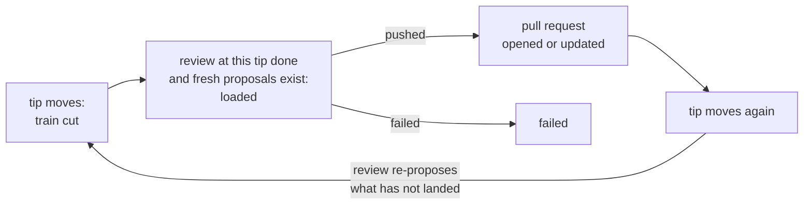

# comment-drift on example/app

Status: proposal. Two charters, a pair the way `docs/working/comment-drift.tony` is one file:
[comment-drift.tony](comment-drift.tony) reviews what lands on master and delivers each fix as a
branch, and [pr.tony](pr.tony) gathers the branches that can still land into one pull request
and keeps it current. The reasons the verse-dev drive gives for its shape are not repeated
here; [comment-drift-states.md](../comment-drift-states.md) reads that one as state machines,
and the review half here is that review with the addresses changed.

## What is different, and why

**master is protected.** A required review, required status checks, a merge queue, no force
push and no deletion. Nothing verse runs can put a commit there, so the verse-dev gate — a
docket question whose yes IS the merge — has no act to release. What a person decides is
decided on the pull request, and the merge is the queue's. Two things follow:

- **No gate.** The verse-dev gate denies on a clock because a merge cannot be quietly undone.
  Pushing a branch and opening a pull request undoes with a click, so the push is `vector: auto`
  and the docket stays empty by design.
- **No `decided`.** A declined batch is a closed pull request, and it is not re-opened until
  master moves and the review proposes again. The forge holds the latch a field used to.

**The train is still per tip, and the pull request outlives it.** A task's id is (rule,
subject), and a spawn on an id that already completed returns the old answer, so a singleton
train would push once. Every tip's train pushes the same ref, `verse/train`, forced, and the
runner's `pull:` option keeps one open pull request from it: a push to the pull request's head
is the update. A train is rebuilt from the tip rather than rebased forward because the review is
idempotent — anything master still lacks is proposed again at the new tip.

**It is a monorepo of Go modules.** A symbol is named from the repository root
(`common/controllers.Reconcile`) so two modules cannot name one thing, `go doc` runs inside the
owning module, and `third_party` and `*.pb.go` are outside the diff the reviewer is pointed at.

## The entities

| entity | what it holds | written by |
|---|---|---|
| `signadot.comment-drift.at` | the cursor: where the review has got to, and what it has claimed | claim, advance |
| `signadot.comment-drift.range.<to>` | one review of `from..to`: its standing set, report, state | open-range, gather, review-range |
| `signadot.comment-drift.finding.<symbol>` | the ledger: one row per symbol, open or resolved | review-range's onDone |
| `signadot.pr.proposal.<branch>` | a delivered branch, the base it was cut from, and whether it went stale | proposal-appeared, -based, -says, -outrun |
| `signadot.pr.train.<tip>` | the batch at one tip of master: its cars, the review's report, and whether it was pushed | train-cut, train-load, train-push |

The pull request itself is the github source's: `github.pr.<example/app#n>` with `head:
verse/train`, and nothing here reads it. The charter's control flow is master's tip and the
ledger; the forge's state is for a reader.

## The train, as state



A train with no cars is loaded with `branches: []` and pushes nothing. A pull request whose
fixes became moot without merging stays open until a person closes it; the charter never
deletes `verse/train`, because the runner refuses a retiring destination over one fixed ref,
and that is the right rule.

## The branch is one string

The tip both charters read is `git.ref."signadot/<branch>"`, and the two environments' `base`
is the same branch. It is `master`. The loop was driven first on `verse/drive`, cut from
master, where commits landed freely and the pull request merged with a click; every path ran
there — open, update, merge, a stale proposal retired, a twenty-commit range — before the
string was changed. Driving it somewhere else again is that string in both charters and both
environments, and a re-seeded cursor.

## What it takes to run

1. **The runner's environments**, `signadot-fix` and `signadot-pr`, are in
   `deploy/coderunner/coderunner.yaml`. The runner's token needs `contents: write` and
   `pull_requests: write` on example/app.
2. **The runner's `pull:` option** on a destination (`docs/reference/examples/coderunner/pull.go`):
   after the push, the task makes sure an open pull request from the ref to the base exists.
3. **The sources.** Staging already mirrors example/app in both the git and github
   sources, so `git.ref."signadot/master"` is there to read.
4. **Install** comment-drift.tony first, since pr.tony reads it, then seed the cursor at
   the branch's tip so the first range is empty:
   ```sh
   verse -addr <addr> charter -a -f docs/working/signadot/comment-drift.tony
   verse -addr <addr> charter -a -f docs/working/signadot/pr.tony
   verse -addr <addr> data signadot comment-drift at --put '{sha: <branch tip>, stage: idle}'
   ```
   When RE-POINTING an installed pair at another branch, seed FIRST and install second: an
   installed charter reads the new branch the moment it lands, and a cursor still standing
   on the old one is a claim across two histories — a range from the old tip to the new
   one, which nothing should review.
5. **verse-dev's merge gate filters on `repo: verse`** — without that it would claim these
   deliveries too, since both repositories' refs reflect under one kind. That is in
   `docs/working/comment-drift.tony` and wants re-installing on a verse that runs both.

## What is left

- **Which car was left behind**, git issue sxz4wejmh12kshy5g9n0. The pull request body points
  at the train entity, and a branch listed there with no commit in the pull request was
  skipped. The charter still does not know.
- **Closing a moot pull request** by hand, above.
- **The repopulate script** does not install these; whether staging runs this drive is a
  deployment decision rather than a charter's.
